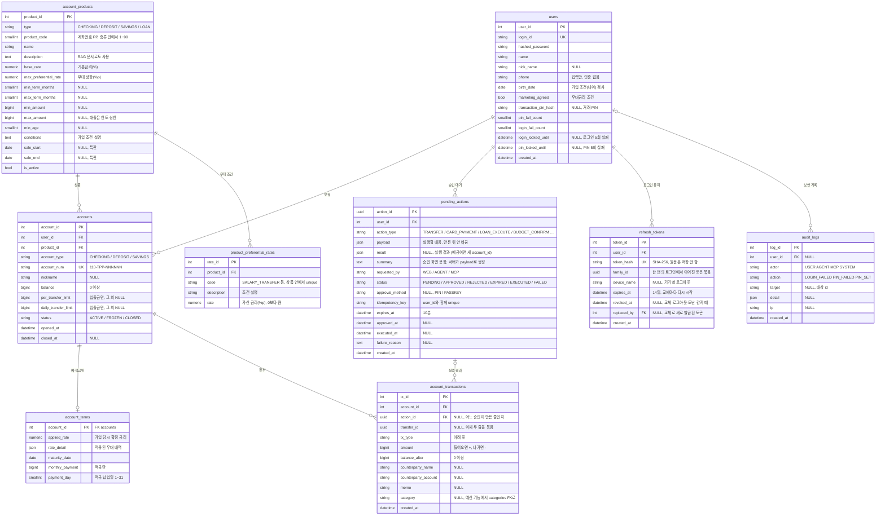

# ER 다이어그램

> **계좌·거래는 종류마다 테이블을 나누지 않고 하나씩 둔다. 사람(또는 Agent)이 시작한 출금·이체·대출 실행·예산 초과 결제는 "승인 대기 작업"을 거치고, 모든 거래는 하나의 장부에 쌓인다.**

결정 이유: [ADR 0003 DB 재설계](decisions/0003-db-redesign.md) · Agent와 승인: [ADR 0004](decisions/0004-agent-integration.md) · 인증: [ADR 0005](decisions/0005-auth.md)

- 이 문서가 **이 레포의 기준 ERD**입니다. `AvengersBankDiagram.drawio`는 팀 뼈대의 원안으로 남겨 둡니다(이 문서와 다릅니다).
- **지금 구현하는 테이블만 그립니다.** 다음 기능에서 추가할 테이블은 아래 [예정](#예정) 표에 있고, 그 기능의 PR에서 이 문서에 옮깁니다.
- 코드의 모델은 `src/avengers_bank/domains/*/models.py`에 있습니다: `users`, `products`(account_products, product_preferential_rates), `accounts`(accounts, account_terms, account_transactions), `approvals`(pending_actions), `users`(refresh_tokens), `audit`(audit_logs). 돈 실행 지점: `accounts/money.py`(ADR 0007). 마이그레이션: `c3d9e1a47b20`(핵심 6개), `d81f4b6c2e90`(우대금리), `e5a72c9d31f4`(refresh token), `f2b8d4e6a913`(감사 기록)

## 핵심 테이블 (구현됨)

- `account_products`: `(type, product_code)` unique, `product_code` 1~99 (ADR 0001). 대출 상품도 `type = LOAN`으로 여기에 둡니다. **판매 중** = `is_active`이고 특판 기간(`sale_start`~`sale_end`)이 있으면 오늘(**한국 날짜**, `core/clock.py`)이 그 안에 있음. `max_preferential_rate`는 **우대 상한**이라 우대 조건 합계와 다를 수 있습니다(데모 seed는 합계를 넣음). 가입 때 적용 금리 = 기본금리 + min(충족한 우대 합계, 상한).
- `product_preferential_rates`: 상품의 우대 조건. 처음에는 예산 그룹의 예정 테이블이었지만, 우대금리는 상품 기능이라 상품 PR에서 만들었습니다. 계좌에는 가입 때 적용된 우대만 `account_terms.rate_detail`에 스냅샷으로 남습니다.
- `account_terms.rate_detail` 예: `[{"code": "SALARY_TRANSFER", "rate": 0.5}, {"code": "MARKETING_AGREED", "rate": 0.2}]`. 가입할 때 한 번 정해지고 바뀌지 않습니다.
- PK는 `int`입니다(현재 코드와 같음). SQLite 테스트에서 `BIGINT PRIMARY KEY`는 자동 증가하지 않기 때문입니다. 금액 칸(`balance`, `amount`, 한도 등)만 `bigint`입니다.
- `account_transactions`에 `(account_id, created_at)` 인덱스를 둡니다. 거래내역 조회와 1일 한도 계산이 이 순서로 찾습니다.

### 승인이 필요한 것과 바로 실행하는 것

**나쁜 일이 생길 수 있는 쪽만 승인을 받습니다.** 안전해지는 쪽(카드 정지)과 사람이 시작하지 않은 것(월급·이자)은 바로 실행합니다.

| 승인 필요 (`pending_actions` + PIN, 나중에 패스키) | 바로 실행 |
|---|---|
| 이체·출금 (**웹에서 시작해도** PIN) | 예산 안 카드 결제, 항상 통과 업종의 카드 결제 ([budget.md](planning/budget.md) "결제 검사") |
| 대출 **실행** (계좌로 입금) | 대출 **신청**·자동 심사 (돈이 움직이지 않음) |
| 예산 초과 확인 (카드 결제는 따로, 이체는 이체 승인과 같은 PIN 한 번) | 월급·이자 같은 시스템 입금, 주기 끝 목표 저축 이체 (사용자가 예산 신청 때 정함) |
| 카드 정지 **해제** | 카드 **정지** (분실 신고는 바로) |
| 예산 검사를 **약하게** 하는 변경 (목록: [ADR 0007](decisions/0007-money-execution-and-budget-guard.md#가드를-약하게-하는-변경)) | 예산 검사를 **강하게** 하는 변경 (같은 표) |
| 잔액이 남은 계좌 해지: 남은 돈을 먼저 이체(승인) | 잔액 0인 계좌 해지 |

### 승인·실행 규칙 (ADR 0004)

1. 승인 요청은 **`action_id` + PIN만** 받습니다. payload는 받지 않습니다(바꿔치기 방지).
2. 승인은 조건부 UPDATE 하나로 시작합니다: `UPDATE pending_actions SET status='APPROVED' WHERE action_id=:id AND user_id=:me AND status='PENDING' AND expires_at > now()`. 바뀐 행이 0이면 거절합니다. 동시에 두 번 승인해도 한 번만 통과하고, 만료를 따로 처리하는 배치가 없어도 시간이 지나면 승인되지 않습니다.
3. 같은 트랜잭션 안에서 **실행 직전에 다시 검사**합니다: 계좌 소유권·상태·잔액·한도. 실패하면 `FAILED` + `failure_reason`.
4. 실행하면 장부 줄에 `action_id`를 남기고 `EXECUTED`로 바꿉니다. 승인 → 실행이 **한 트랜잭션**이어서 서버가 중간에 죽으면 통째로 되돌아가 `PENDING`으로 남습니다. `APPROVED`로 멈춘 행은 생기지 않습니다.
5. `summary`는 Agent가 쓴 문장이 아니라 **서버가 payload로 만듭니다** ("5만 원"이라 적고 실제로 500만 원을 보내는 것 방지).
6. `idempotency_key`는 **요청한 쪽**(웹·Agent·MCP)이 만들고, `(user_id, idempotency_key)`가 unique입니다. 같은 키가 다시 오면 새 행을 만들지 않고 기존 행을 돌려줍니다. 예산을 넘는 건이 실행 때 승인 때보다 나빠지면 `FAILED`로 끝나고, 사용자가 새 키로 다시 요청합니다([ADR 0007](decisions/0007-money-execution-and-budget-guard.md)).
7. PIN을 5번 틀리면 `pin_locked_until`만 잠깁니다. **로그인은 잠기지 않아서** 토큰을 가진 Agent가 PIN을 틀려도 사용자를 쫓아낼 수 없습니다. PIN 실패 횟수는 PIN이 맞으면 0으로 돌아갑니다.

### 거래 종류 (`tx_type`)

| 값 | 뜻 | 금액 | 예산에서 |
|---|---|---|---|
| `DEPOSIT` | 입금 (월급 등) | + | 수입 |
| `WITHDRAW` | 출금 | − | 쓴 돈 |
| `TRANSFER_IN` / `TRANSFER_OUT` | 다른 사람과의 이체 | + / − | 수입 / 쓴 돈 |
| `INTERNAL_IN` / `INTERNAL_OUT` | 내 계좌끼리 이동 | + / − | 셈하지 않음 |
| `CARD_PAYMENT` | 체크카드 결제 | − | 쓴 돈 |
| `CARD_BILL` | 신용카드 대금 출금 | − | 셈하지 않음 (쓴 순간 셈) |
| `GOAL_SAVING_IN` / `GOAL_SAVING_OUT` | 목표 저축 이체 | + / − | 셈하지 않음 (묶어 둔 돈) |
| `INTEREST` | 이자 | + | 수입 |
| `LOAN_DISBURSE` | 대출금 입금 | + | 셈하지 않음 |
| `LOAN_REPAY` | 대출 상환 출금 | − | 고정 지출 |
| `REFUND` | 환불·취소 | + | 수입 (다른 주기) 또는 차감 취소 (같은 주기) |

## 예정

기능을 만들 때 그 PR에서 추가합니다. 컬럼은 그때 확정합니다.

| 기능 (구현 순서) | 테이블 | 주요 컬럼 |
|---|---|---|
| 카드 | `card_products` | type(CREDIT/DEBIT), name, annual_fee, benefits |
| 카드 | `cards` | user_id, product_id, card_type, card_num, linked_account_id, daily_limit, monthly_limit, payment_day, status(ACTIVE/SUSPENDED/LOST) |
| 카드 | `card_transactions` | card_id, merchant_name, category, amount, is_overseas, status(APPROVED/CANCELED), billing_status, account_tx_id |
| 대출 | `loans` | user_id, product_id, loan_num(110-4PP-…), account_id, principal, remaining_principal, applied_rate, term_months, status. `account_products`에 `income_multiplier`(한도 = 연소득 × 배수) 추가 |
| 대출 | `loan_schedules` | loan_id, seq, due_date, principal_amount, interest_amount, status, paid_tx_id |
| 예산 | `categories` | name, is_essential, is_daily, default_always_pass (신청 때 보여 줄 추천값. 실제 설정은 사용자별로 `budget_profiles`에, ADR 0007) |
| 예산 | `budget_profiles`, `fixed_expenses`, `savings_goals`, `budget_cycles`, `budget_decisions` | [budget.md](planning/budget.md) 참고. `budget_cycles`가 결제 검사 때 잠그는 행 |
| Agent | `recipients` | user_id, bank_name, account_num, holder_name, nickname, last_sent_at |
| Agent | `chat_messages` | user_id, session_id, channel(WEB/MCP), role, content, intent, action_id |
| RAG | `rag_chunks` | content, embedding(pgvector), metadata(출처·제목) |
| 2차 | `passkeys` | user_id, credential_id, public_key, sign_count |
| 범위 안, 나중 | `notifications` | user_id, type, message, link, is_read |

## 코드에서 지켜야 할 규칙

DB 제약으로 막는 것은 ✅, 코드에서 지켜야 하는 것은 📝입니다.

| # | 규칙 | |
|---|---|---|
| 1 | **계좌번호 형식** `110-TPP-NNNNNN`. 종류 코드는 `accounts.account_type`과 맞아야 함 (입출금 1, 예금 2, 적금 3, 대출 4) | ✅ CHECK (종류 코드·길이), 📝 숫자는 `make_account_num` |
| 2 | **잔액은 0 이상**, 장부의 `balance_after`도 0 이상. **금액 부호는 거래 종류와 맞아야 함**(들어오는 종류는 +, 나가는 종류는 −, 아래 표) | ✅ CHECK |
| 3 | **입출금 계좌만 이체 한도가 있음**(1회 한도 > 0, 1일 한도 ≥ 1회 한도), 예·적금만 `account_terms`가 있음 | ✅ CHECK (한도), 📝 (terms) |
| 4 | **돈 이동은 한 트랜잭션으로**: 잔액 변경 + 장부 줄 저장 + `pending_actions` 상태 변경을 `async with db.begin():` 하나 안에서 | 📝 |
| 5 | **잠금 순서**: (예산 기능 이후) 예산 주기 행 → 계좌 행(계좌 id 오름차순) | 📝 교착 방지 |
| 6 | **이체는 장부 두 줄**(보낸 쪽 −, 받는 쪽 +)을 같은 `transfer_id`로 | 📝 |
| 7 | **상품 종류 검증**: 계좌·카드·대출을 만들 때 상품 `type`이 맞는지 | 📝 |
| 8 | **금액은 정수(원)**, 실수형 금지 | ✅ BIGINT |
| 9 | **승인은 사람만**: `pending_actions` 승인 API는 PIN·패스키가 필요하고, Agent·MCP 도구에는 없음 | 📝 (ADR 0004) |
| 10 | (카드·대출 이후) **카드·대출의 `user_id`는 연결 계좌의 `user_id`와 같아야 함** | 📝 만들 때 검사 |
| 11 | (카드 이후) **카드 누적 사용액은 저장하지 않고 계산** | 📝 동기화 버그 방지 |
| 12 | **1일 이체 한도는 오늘 `TRANSFER_OUT` 합계**로 계산 (내 계좌끼리 이동·카드 결제는 넣지 않음) | 📝 |
| 13 | **잔액·장부를 바꾸는 일은 모두 실행 함수 하나를 지남**. 잔액을 바꾸는 코드는 그 함수 안에만 있고, 예산 가드(지출만)도 거기 하나 ([ADR 0007](decisions/0007-money-execution-and-budget-guard.md)) | 📝 |

## 이 레포에서 정한 것 (팀 뼈대에서는 미정)

결정 이유: [ADR 0008](decisions/0008-account-opening-policy.md)

| 항목 | 정한 값 | 바꾸는 곳 |
|---|---|---|
| 이체 한도 기본값 | 1회 100만 원, 1일 500만 원 (입출금 계좌 개설 때) | `domains/accounts/service.py` |
| 일련번호 발급 | 같은 `110-TPP-` 안에서 가장 큰 번호 + 1. 동시에 같은 상품을 열어 겹치면 `409` | shortcut. 자주 겹치면 DB 시퀀스로 |
| 남의 계좌 접근 | `404 ACCOUNT_NOT_FOUND` (403은 계좌가 있다는 것을 알려 줌) | `domains/accounts/service.py` |

## 팀에서 정해야 할 것

- 카드번호 형식
