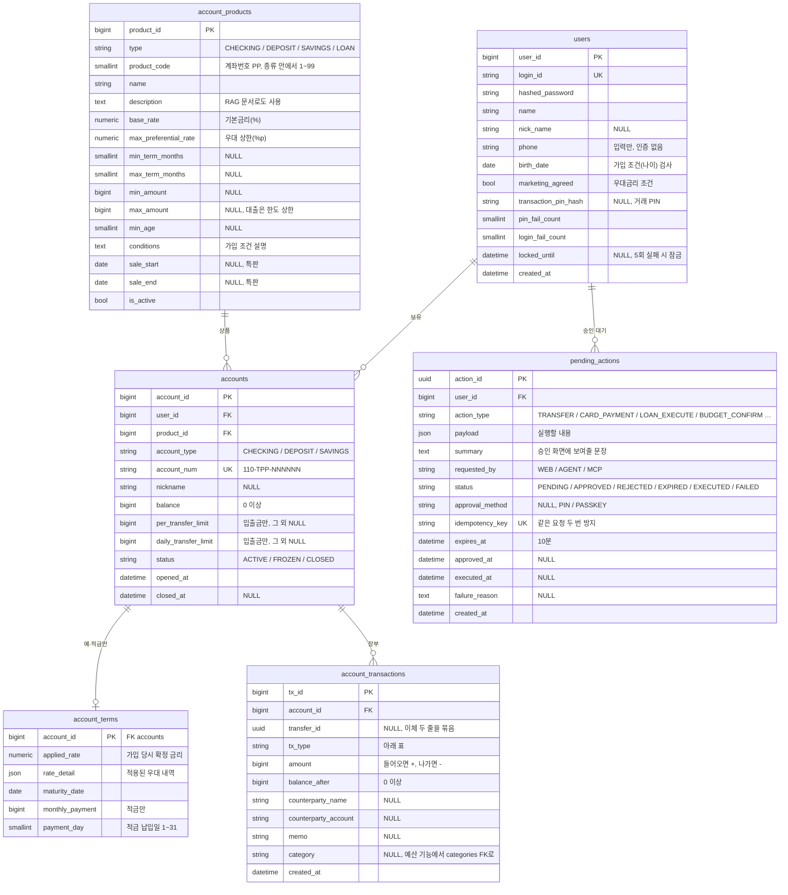

# ER 다이어그램

> **계좌·거래는 종류마다 테이블을 나누지 않고 하나씩 둔다. 돈이 움직이는 일은 모두 "승인 대기 작업"을 거치고, 거래는 하나의 장부에 쌓인다.**

결정 이유: [ADR 0003 DB 재설계](decisions/0003-db-redesign.md) · Agent와 승인: [ADR 0004](decisions/0004-agent-integration.md) · 인증: [ADR 0005](decisions/0005-auth.md)

- 이 문서가 **이 레포의 기준 ERD**입니다. `AvengersBankDiagram.drawio`는 팀 뼈대의 원안으로 남겨 둡니다(이 문서와 다릅니다).
- **지금 구현하는 테이블만 그립니다.** 다음 기능에서 추가할 테이블은 아래 [예정](#예정) 표에 있고, 그 기능의 PR에서 이 문서에 옮깁니다.
- 코드의 모델은 `src/avengers_bank/domains/*/models.py`에 있습니다.

## 핵심 테이블 (첫 구현)

- `account_products`: `(type, product_code)` unique, `product_code` 1~99 (ADR 0001). 대출 상품도 `type = LOAN`으로 여기에 둡니다.
- `account_terms.rate_detail` 예: `[{"code": "SALARY_TRANSFER", "rate": 0.5}, {"code": "MARKETING_AGREED", "rate": 0.2}]`. 가입할 때 한 번 정해지고 바뀌지 않습니다.
- 돈이 움직이는 요청은 **바로 실행하지 않고 `pending_actions`를 만든 뒤, 사용자가 PIN(나중에 패스키)으로 승인해야** 실행합니다. 상태는 `PENDING → APPROVED → EXECUTED` 순서로만 바뀌어서 한 번만 실행됩니다(ADR 0004).

### 거래 종류 (`tx_type`)

| 값 | 뜻 | 금액 | 예산에서 |
|---|---|---|---|
| `DEPOSIT` | 입금 (월급 등) | + | 수입 |
| `WITHDRAW` | 출금 | − | 쓴 돈 |
| `TRANSFER_IN` / `TRANSFER_OUT` | 다른 사람과의 이체 | + / − | 수입 / 쓴 돈 |
| `INTERNAL_IN` / `INTERNAL_OUT` | 내 계좌끼리 이동 | + / − | 셈하지 않음 |
| `CARD_PAYMENT` | 체크카드 결제 | − | 쓴 돈 |
| `CARD_BILL` | 신용카드 대금 출금 | − | 셈하지 않음 (쓴 순간 셈) |
| `GOAL_SAVING_IN` / `GOAL_SAVING_OUT` | 목표 저축 이체 | + / − | 셈하지 않음 (묶어 둔 돈) |
| `INTEREST` | 이자 | + | 수입 |
| `LOAN_DISBURSE` | 대출금 입금 | + | 셈하지 않음 |
| `LOAN_REPAY` | 대출 상환 출금 | − | 고정 지출 |
| `REFUND` | 환불·취소 | + | 수입 (다른 주기) 또는 차감 취소 (같은 주기) |

## 예정

기능을 만들 때 그 PR에서 추가합니다. 컬럼은 그때 확정합니다.

| 기능 (구현 순서) | 테이블 | 주요 컬럼 |
|---|---|---|
| 보안 보강 | `refresh_tokens` | user_id, token_hash, device_name, expires_at, revoked_at, replaced_by |
| 보안 보강 | `audit_logs` | user_id, actor(USER/AGENT/MCP/SYSTEM), action, target, detail. **로그인 실패·승인 실패처럼 장부와 승인 대기에 남지 않는 것만** |
| 카드 | `card_products` | type(CREDIT/DEBIT), name, annual_fee, benefits |
| 카드 | `cards` | user_id, product_id, card_type, card_num, linked_account_id, daily_limit, monthly_limit, payment_day, status(ACTIVE/SUSPENDED/LOST) |
| 카드 | `card_transactions` | card_id, merchant_name, category, amount, is_overseas, status(APPROVED/CANCELED), billing_status, account_tx_id |
| 대출 | `loans` | user_id, product_id, loan_num(110-4PP-…), account_id, principal, remaining_principal, applied_rate, term_months, status. `account_products`에 `income_multiplier`(한도 = 연소득 × 배수) 추가 |
| 대출 | `loan_schedules` | loan_id, seq, due_date, principal_amount, interest_amount, status, paid_tx_id |
| 예산 | `product_preferential_rates` | product_id, code, description, rate |
| 예산 | `categories` | name, is_essential, is_daily, always_pass |
| 예산 | `budget_profiles`, `fixed_expenses`, `savings_goals`, `budget_cycles`, `budget_decisions` | [budget.md](planning/budget.md) 참고. `budget_cycles`가 결제 검사 때 잠그는 행 |
| Agent | `recipients` | user_id, bank_name, account_num, holder_name, nickname, last_sent_at |
| Agent | `chat_messages` | user_id, session_id, channel(WEB/MCP), role, content, intent, action_id |
| RAG | `rag_chunks` | content, embedding(pgvector), metadata(출처·제목) |
| 2차 | `passkeys` | user_id, credential_id, public_key, sign_count |
| 범위 안, 나중 | `notifications` | user_id, type, message, link, is_read |

## 코드에서 지켜야 할 규칙

DB 제약으로 막는 것은 ✅, 코드에서 지켜야 하는 것은 📝입니다.

| # | 규칙 | |
|---|---|---|
| 1 | **계좌번호 형식** `110-TPP-NNNNNN`. 종류 코드는 `accounts.account_type`과 맞아야 함 (입출금 1, 예금 2, 적금 3, 대출 4) | ✅ CHECK (종류 코드·길이), 📝 숫자는 `make_account_num` |
| 2 | **잔액은 0 이상**, 장부의 `balance_after`도 0 이상 | ✅ CHECK |
| 3 | **입출금 계좌만 이체 한도가 있음**, 예·적금만 `account_terms`가 있음 | ✅ CHECK (한도), 📝 (terms) |
| 4 | **돈 이동은 한 트랜잭션으로**: 잔액 변경 + 장부 줄 저장 + `pending_actions` 상태 변경을 `async with db.begin():` 하나 안에서 | 📝 |
| 5 | **잠금 순서**: (예산 기능 이후) 예산 주기 행 → 계좌 행(계좌 id 오름차순) | 📝 교착 방지 |
| 6 | **이체는 장부 두 줄**(보낸 쪽 −, 받는 쪽 +)을 같은 `transfer_id`로 | 📝 |
| 7 | **상품 종류 검증**: 계좌·카드·대출을 만들 때 상품 `type`이 맞는지 | 📝 |
| 8 | **금액은 정수(원)**, 실수형 금지 | ✅ BIGINT |
| 9 | **승인은 사람만**: `pending_actions` 승인 API는 PIN·패스키가 필요하고, Agent·MCP 도구에는 없음 | 📝 (ADR 0004) |
| 10 | (카드·대출 이후) **카드·대출의 `user_id`는 연결 계좌의 `user_id`와 같아야 함** | 📝 만들 때 검사 |
| 11 | (카드 이후) **카드 누적 사용액은 저장하지 않고 계산** | 📝 동기화 버그 방지 |

## 팀에서 정해야 할 것

- 카드번호 형식
- 이체 한도 기본값
- 일련번호 발급 방식 (DB 시퀀스 추천)
