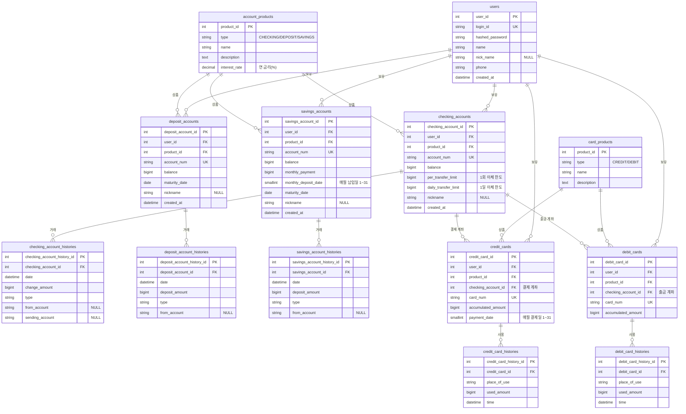

# ER 다이어그램

- 원본 파일: [`AvengersBankDiagram.drawio`](AvengersBankDiagram.drawio). [draw.io](https://app.diagrams.net)에서 열어서 수정합니다.
- 아래 다이어그램은 같은 내용을 GitHub에서 바로 볼 수 있도록 Mermaid로 옮긴 것입니다. drawio를 수정하면 이 문서도 함께 고쳐 주세요.
- 코드의 모델은 `src/avengers_bank/domains/*/models.py`에 있습니다.

## 테이블 요약

| 테이블 | 설명 | 도메인 |
|---|---|---|
| `users` | 회원 | users |
| `account_products` / `card_products` | 계좌 상품 / 카드 상품 | products |
| `checking_accounts` / `deposit_accounts` / `savings_accounts` | 입출금 / 예금 / 적금 계좌 | accounts |
| `*_account_histories` | 계좌별 거래내역 | accounts |
| `credit_cards` / `debit_cards` | 신용카드 / 체크카드 | cards |
| `*_card_histories` | 카드별 사용내역 | cards |

## 코드에서 지켜야 할 규칙

DB 구조만으로는 막을 수 없는 부분이라 애플리케이션 코드에서 보장해야 합니다.

1. **계좌번호 중복 방지:** 계좌 테이블이 3개라서 `account_num`이 테이블 사이에서 겹칠 수 있습니다. 계좌번호는 `accounts.service`에서만 발급하고, 세 테이블을 모두 검사합니다.
2. **돈 이동은 한 트랜잭션으로:** 이체, 적금 납입, 체크카드 결제는 잔액 변경과 History 저장(양쪽 모두)을 `async with db.begin():` 블록 하나 안에서 처리합니다.
3. **상품 종류 검증:** 계좌를 개설하거나 카드를 발급할 때 상품의 `type`이 계좌·카드 종류와 맞는지 확인합니다.
4. **`accumulated_amount` 동기화:** 카드 History를 저장할 때 이 값도 같이 증가시킵니다.
5. **금액은 정수(원):** 금액 컬럼은 모두 `BIGINT`입니다. 실수형(`float`)은 쓰지 않습니다.

## 팀에서 정해야 할 것

- 각 `type` 컬럼에 들어갈 값 목록 (예: 거래내역 `DEPOSIT`, `WITHDRAW`, `TRANSFER_IN`, `TRANSFER_OUT`, `CARD_PAYMENT`)
- 계좌번호와 카드번호를 만드는 형식
- 이체 한도 기본값
