# 실제 구현 화면 기록 (버전별 캡처)

상위 폴더의 01~43번 PNG는 **만들기 전에 그린 시안**이고, 이 폴더는 **실제로 돌아가는 앱을 찍은 화면**입니다. 디자인을 바꿀 때마다 새 버전 폴더를 만들고, 무엇을 왜 바꿨는지 아래 표에 한 줄씩 남깁니다.

## 찍는 방법 (다음 버전도 같은 조건으로)

- 화면 크기 375×812 (모바일), 데모 계정(`demo`)으로 로그인한 상태
- 화면 순서와 파일 이름은 고정: `01-login` → `02-home-top` → `03-home-bottom` → `04-products` → `05-ai-chat` → `06-cards-large` → `07-cards-list` → `08-menu`
- 폴더 이름: `v<번호>-<날짜>-<한 단어 설명>`
- 금액·거래내역은 찍은 날의 데모 데이터라 버전마다 다를 수 있습니다. 파일마다 해상도가 다른 것(375 또는 750px 폭)은 캡처 도구 차이이며 같은 화면 크기입니다.

## 버전 목록

| 버전 | 날짜 | 무엇을 | 결정 기록 |
|---|---|---|---|
| [v1](v1-2026-11-11-before/) | 2026-11-11 | 개편 직전 상태 (main `7b36f5c`). 시안 14·15·20·21·23·25번을 따라 구현한 화면 | [ADR 0021](../../decisions/0021-ui-components.md) |
| [v2](v2-2026-11-11-compact/) | 2026-11-11 | 여백 줄이기, AI 상담 채팅형 개편, 로그인 화면 다시 디자인 | [ADR 0027](../../decisions/0027-compact-layout-chat-login.md) |

## v1 → v2 화면별 비교

| 화면 | v1 (전) | v2 (후) | 바뀐 점 |
|---|---|---|---|
| 로그인 | 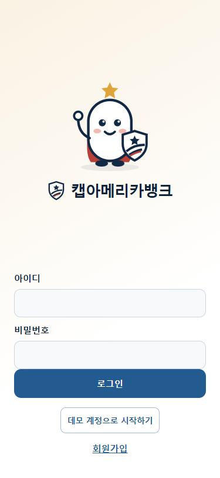 | 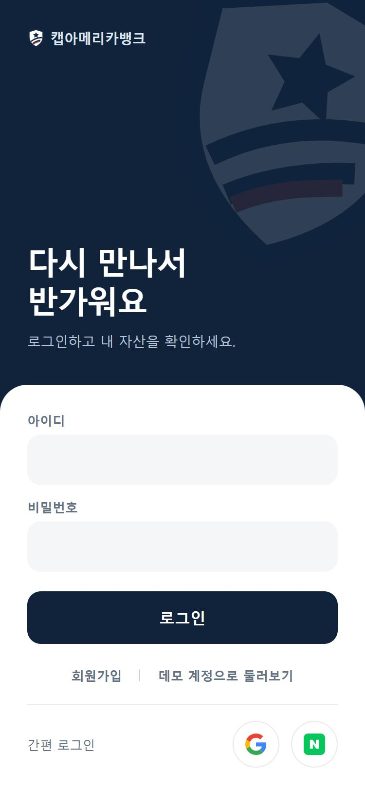 | 시안 B(네이비 배경 + 흰 시트)로 변경. 큰 인사말, 회색 면 입력칸, 버튼과 14px 간격. 회원가입·데모는 한 줄 글자 링크. 간편 로그인(Google·네이버)은 동그란 아이콘 자리 (아직 연결 전, 누르면 준비 중 안내). 비교한 A·C는 아래 시안 비교 참고 |
| 홈 (위) | 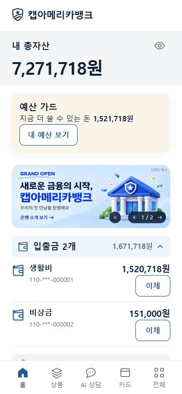 | 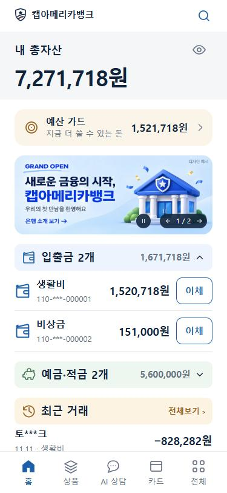 | 은행명을 작게, 오른쪽에 거래 검색 아이콘. 예산 가드를 한 줄 카드로. 계좌 금액과 이체 버튼을 한 줄에 |
| 홈 (아래) | 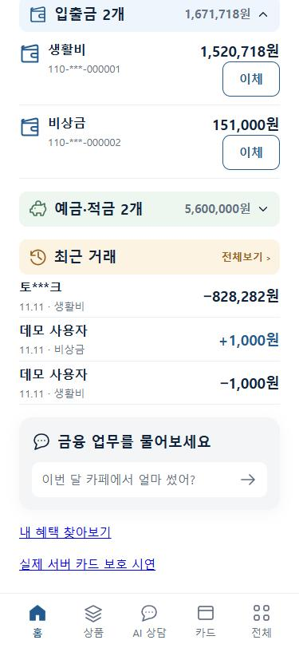 | 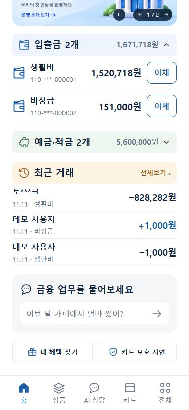 | 밑줄 링크 두 줄을 아이콘 버튼 두 칸으로 |
| 상품 | 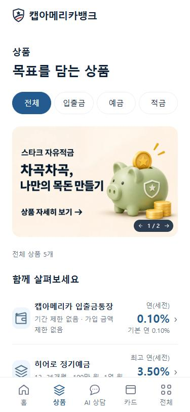 | 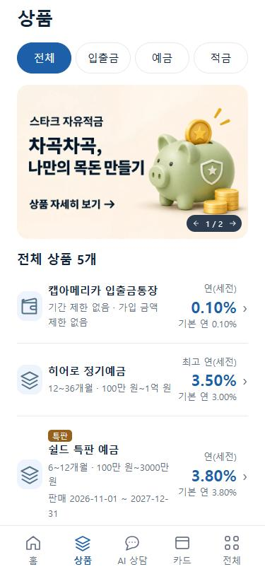 | 은행명 머리글과 두 줄 제목을 "상품" 한 줄로. "전체 상품 5개"와 "함께 살펴보세요"를 한 줄로 합침 |
| AI 상담 | 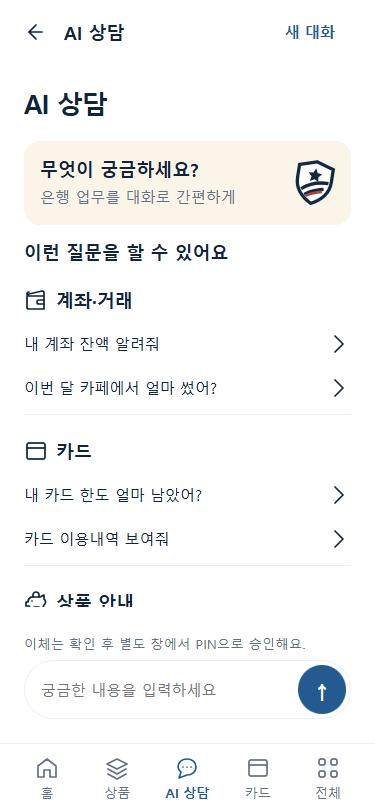 | 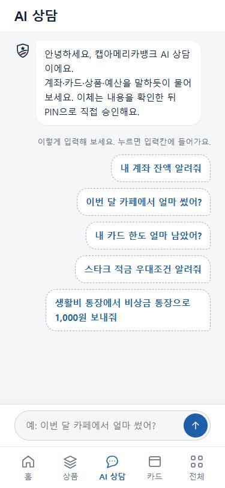 | 질문 목록 버튼 → 채팅형. AI 인사 말풍선과 점선 예시 말풍선(누르면 입력칸에 채움). 대화 영역은 회색, 입력줄은 흰색 + 윗선 |
| 카드 (크게) | 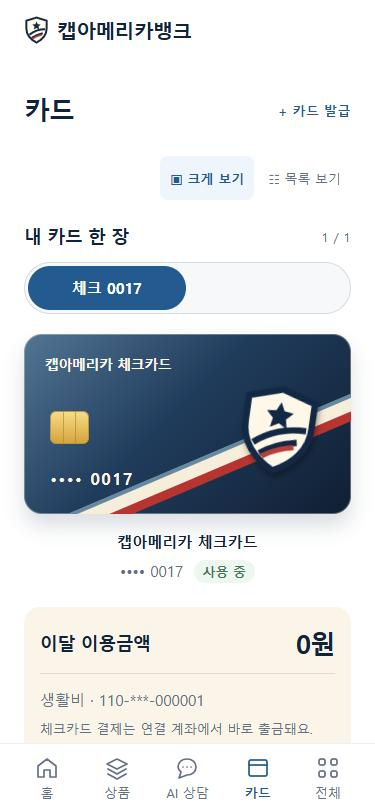 | 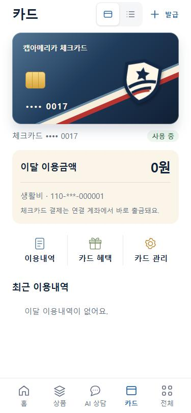 | 보기 전환을 제목 줄의 아이콘 버튼으로. 카드가 한 장이면 선택 줄을 숨김. 카드 그림과 겹치던 카드명 제거 |
| 카드 (목록) | 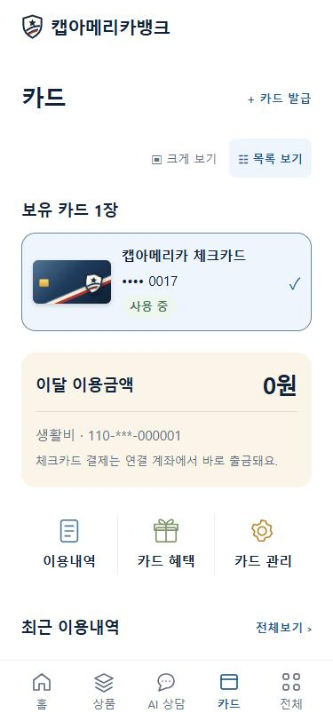 | 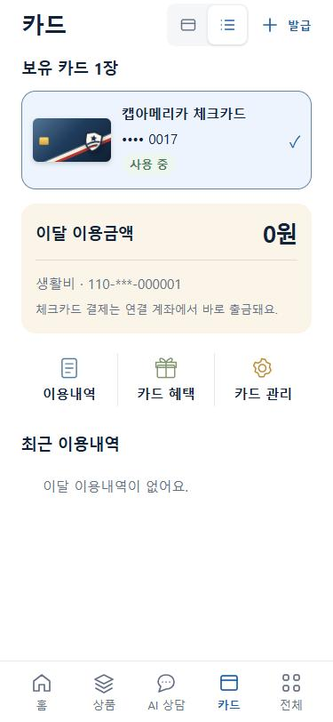 | 같은 머리글. 중복된 "전체보기" 제거 |
| 전체 메뉴 | 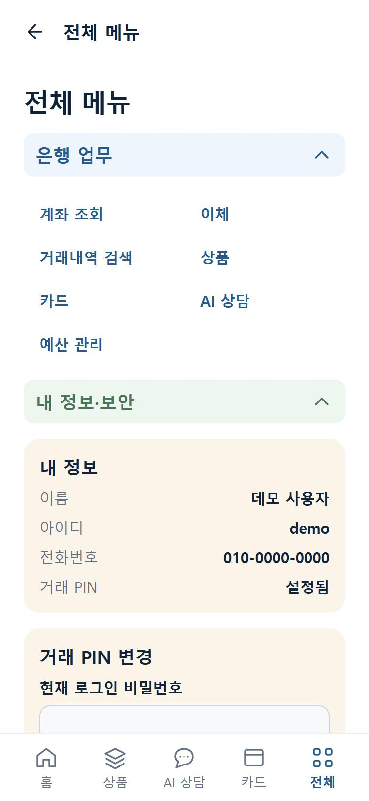 | 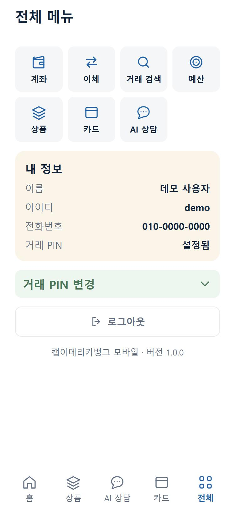 | 제목 중복 제거, 글자 버튼 2열 → 아이콘 타일 4열, PIN 변경 폼은 접어 둠, 중복된 검색 줄 제거 |

## 로그인 화면 시안 비교 (2026-11-11) — **B 선택**

같은 폼·같은 동작으로 모양만 다른 세 가지를 만들어 비교했고 **B를 골랐습니다.** 고르지 않은 A·C도 지우지 않습니다. 다만 앱에는 B 하나만 두고, A·C는 나중에 다시 쓸 수 있게 코드와 캡처를 이 폴더에 기록으로 남깁니다(앱에서 열리는 주소는 없습니다).

| 시안 | 상태 | 코드 |
|---|---|---|
| A. 캐릭터 + 알약 | 보관 | [archived-code/login-a.mjs](login-options-2026-11-11/archived-code/login-a.mjs), [login-a.css](login-options-2026-11-11/archived-code/login-a.css) |
| **B. 네이비 배경 + 흰 시트** | **선택 (앱에서 사용)** | `frontend/login.mjs`의 `loginView`, `frontend/login.css` |
| C. 글자 + 사선 띠 | 보관 | [archived-code/login-c.mjs](login-options-2026-11-11/archived-code/login-c.mjs), [login-c.css](login-options-2026-11-11/archived-code/login-c.css) |

> 2026-11-11 수정: 처음에는 A·C를 앱에 남겨 `?login=a`·`?login=c`로 열리게 했지만, 그 주소를 없애고 이 보관 폴더로 옮겼습니다 ([ADR 0027](../../decisions/0027-compact-layout-chat-login.md)).

| A. 캐릭터 + 알약 (보관) | B. 네이비 배경 + 흰 시트 (선택) | C. 글자 + 사선 띠 (보관) |
|---|---|---|
|  |  | 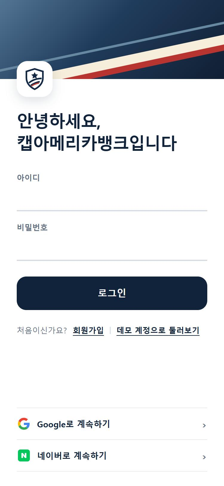 |
| 가운데 정렬, 캐릭터가 주인공. 입력칸·버튼 모두 알약 모양. 간편 로그인은 세로 버튼(Google 위) | 네이비 위에 큰 인사말과 방패 워터마크, 아래에서 올라온 흰 시트에 폼. 입력칸은 회색 면. 간편 로그인은 동그란 아이콘 두 개 | 그림 없이 왼쪽 정렬 큰 글자. 카드의 사선 띠를 위에 두고 입력칸은 밑줄만. 간편 로그인은 목록 줄 |
| 친근함. 캐릭터가 임시라 바뀌면 인상이 달라짐 | 은행다운 무게감. 화면 절반이 어두워 다른 화면(밝은 크림·흰색)과 대비가 큼 | 가장 담백하고 카드 디자인과 이어짐. 캐릭터 없이도 성립 |

**기록 원칙: 고르지 않은 안도 지우지 않습니다.** 시안 이미지(상위 폴더 01~43번)와 마찬가지로, 구현까지 한 대안도 코드·캡처·보는 방법을 남깁니다.

## 시안과 달라진 점

- **AI 상담**: 시안은 [20번(질문 목록형)](../20-ai-chat-option-3-selected.png)을 골랐지만, 실제로 만들어 보니 "버튼을 고르는 화면"처럼 보여 대화 서비스라는 점이 드러나지 않았습니다. v2는 처음부터 대화 모양으로 예시를 보여 줍니다. 20번은 이력으로 남깁니다.
- **전체 메뉴**: 시안 [25번](../25-all-menu-option-2.png)의 세 묶음 접기 대신, 자주 쓰는 은행 업무는 [24번](../24-all-menu-option-1.png)처럼 아이콘으로 펼쳐 두고 PIN 폼만 접습니다.
- **로그인**: 시안이 없던 화면입니다. 구현 화면으로 세 안을 비교해 B를 골랐고, v2가 첫 디자인 기준입니다.
