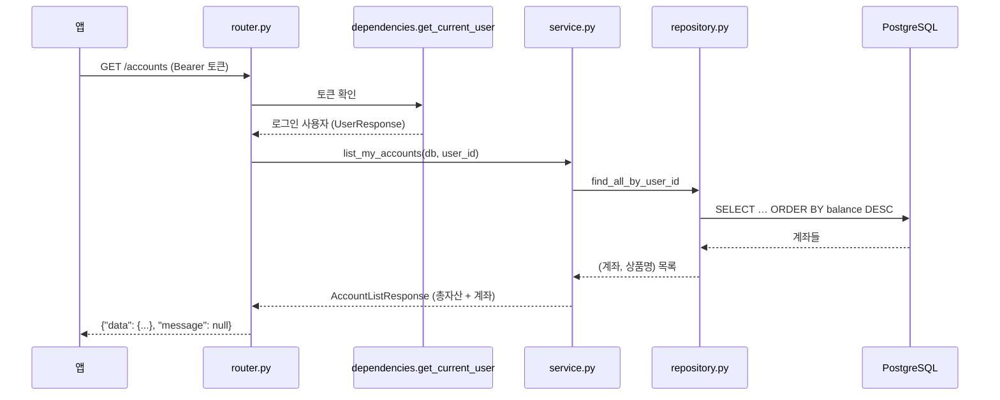

# 1. 큰 그림: 요청 하나가 지나가는 길

> **router는 받고, service는 규칙과 트랜잭션, repository는 DB만. 오류는 `ApiException` 하나로 던지면 공통 형식으로 바뀐다.**

## 폴더와 역할

```
src/avengers_bank/
├── main.py              앱 만들기, 라우터 등록, 예외 처리기 등록
├── core/                모든 도메인이 같이 씀
│   ├── config.py        .env 읽기 (DB 주소, JWT 비밀키, 토큰 수명)
│   ├── database.py      DB 연결, Base, get_db, in_sql (CHECK 문장 만들기)
│   ├── security.py      비밀번호 해시(Argon2), JWT, refresh token 해시(SHA-256)
│   ├── dependencies.py  get_current_user: "Authorization: Bearer …" → 로그인 사용자
│   ├── exceptions.py    BadRequest(400) · Unauthorized(401) · Forbidden(403) · NotFound(404) · Conflict(409) · Locked(423)
│   ├── exception_handlers.py  예외 → {"error": {"code", "message"}} 로 바꿈
│   └── clock.py         한국 날짜 (today_kst)
└── domains/             업무별 폴더. 각자 router / service / repository / models / schemas
    users · products · accounts · approvals · transfers · audit · cards(준비 중)
```

## 요청 하나 따라가기: `GET /accounts` (메인 화면)



| 단계 | 파일 | 하는 일 |
|---|---|---|
| 받기 | `domains/accounts/router.py` | 경로·입력 모양 확인(Pydantic), 로그인 확인(`Depends(get_current_user)`), 결과를 `SuccessResponse`로 감쌈 |
| 규칙 | `domains/accounts/service.py` | "해지한 계좌는 빼고, 총자산은 합계" 같은 규칙. 쓰기가 있으면 `async with db.begin():` |
| DB | `domains/accounts/repository.py` | SELECT·INSERT·UPDATE 문장만. 업무 규칙은 넣지 않음 |

## 규칙 세 가지

**1. 트랜잭션은 service가 연다**
```python
async with db.begin():          # 이 블록이 끝나면 커밋, 예외가 나면 전부 되돌림
    ...잔액 변경, 장부 기록, 승인 상태 변경...
```
돈이 움직이는 일은 이 블록 **하나** 안에서 끝냅니다(ERD 규칙 4). 중간에 서버가 죽으면 전부 되돌아갑니다.

**2. 오류는 예외로 던지고, 모양은 한 곳에서 만든다**
```python
raise BadRequestException(message="잔액이 부족합니다.", code="INSUFFICIENT_BALANCE")
# → 400 {"error": {"code": "INSUFFICIENT_BALANCE", "message": "잔액이 부족합니다.", "details": []}}
```
`code`는 화면과 Agent가 분기할 때 쓰는 고정 값, `message`는 사람에게 보여 주는 문장입니다.

**3. 실패를 기록해야 하면 "커밋한 뒤에" 던진다**

로그인 실패 횟수처럼 실패해도 남겨야 하는 것은, 블록 **안에서** 던지면 되돌아가서 사라집니다. 그래서 블록 안에서는 기록만 하고, 블록이 끝난 뒤에 예외를 던집니다. 로그인·PIN·refresh 교체·승인 실패가 모두 이 모양입니다.

## DB와 테스트

| | 운영·CI | 테스트 |
|---|---|---|
| DB | PostgreSQL 17 | SQLite (파일) |
| 테이블 만들기 | Alembic 마이그레이션 (`alembic/versions/`) | 모델에서 바로 `create_all` |
| 확인 | CI가 PostgreSQL에 upgrade → `alembic check` → downgrade → upgrade | `uv run pytest` |

SQLite는 시간대를 버리고 저장해서, 시간은 **항상 UTC로 저장·비교**합니다(`clock.py`, `money.py`의 주석). `alembic check`는 CHECK 제약 변경을 못 잡아서 `tests/test_account_number.py`가 모델과 마이그레이션의 CHECK를 비교합니다.

## 면접 예상 질문

**Q. 왜 router / service / repository로 나눴나요?**
A. 바뀌는 이유가 달라서입니다. 경로·입력 모양이 바뀌면 router, 업무 규칙이 바뀌면 service, 쿼리가 바뀌면 repository만 고칩니다. 특히 트랜잭션 경계를 service에 두면 "잔액 변경과 장부 기록이 한 트랜잭션"을 한 곳에서 보장할 수 있습니다.

**Q. 오류 응답 형식을 어떻게 통일했나요?**
A. 모든 업무 오류를 `ApiException`의 하위 클래스로 던지고, `exception_handlers.py`가 `{"error": {"code", "message"}}`로 바꿉니다. 입력 형식 오류(422)와 예상 못 한 오류(500)도 같은 모양으로 바꿔서 앱은 한 가지 형식만 처리하면 됩니다.

**Q. 테스트를 SQLite로 돌리면 PostgreSQL과 다르지 않나요?**
A. 다릅니다. CI에서 실제 PostgreSQL에 마이그레이션을 올렸다 내렸다 하고, 시간 비교처럼 두 DB가 다르게 동작하는 곳은 UTC로 통일했습니다. 동시성은 두 가지로 지킵니다.
- **조건부 UPDATE 한 문장**(로그인·PIN 시도 예약, 승인, 토큰 교체): DB 종류와 상관없이 맞고 SQLite 테스트로도 확인합니다.
- **행 잠금 `FOR UPDATE`**(잔액 변경): PostgreSQL에서만 동작하고 SQLite는 무시합니다. 그래서 "동시에 두 출금이 와도 잔액이 맞는가"는 **지금 테스트로 확인하지 못합니다.** 다음 단계는 CI에서 PostgreSQL로 동시성 테스트를 돌리는 것입니다.

**Q. 돈은 왜 정수(BIGINT)로 저장하나요?**
A. 원 단위 정수로만 저장해서 소수 오차가 생기지 않게 했습니다(`0.1 + 0.2 ≠ 0.3` 문제). 금리처럼 소수가 필요한 값은 `Numeric(5, 2)`(파이썬 `Decimal`)로 정확한 소수를 쓰고, API로 보낼 때도 문자열로 보내서 JavaScript의 부동소수점 오차를 피합니다.
