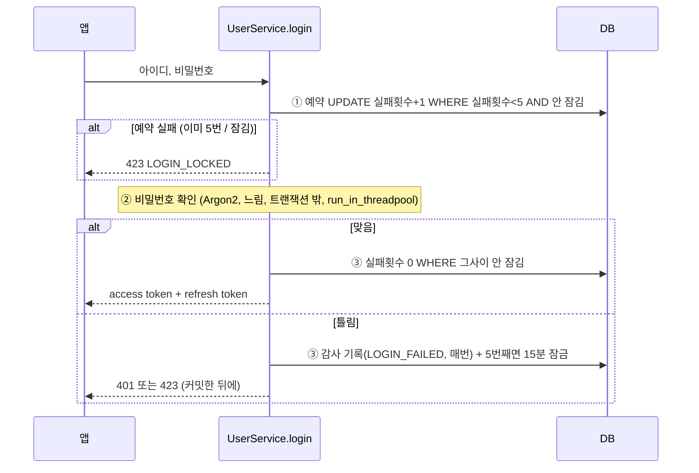

# 2. 회원·인증

> **로그인은 "누구인지", 거래 PIN은 "지금 본인이 승인하는지"를 확인한다. 비밀번호·PIN 시도는 확인하기 전에 먼저 예약해서 동시 요청에도 5번 제한이 지켜진다. refresh token은 쓸 때마다 바뀌고, 이미 바꾼 토큰이 다시 오면 도난으로 본다.**

결정 원문: [ADR 0005](../decisions/0005-auth.md)

## 코드 위치

| 기능 | API | 코드 |
|---|---|---|
| 회원가입 | `POST /users/signup` | `users/service.py` `signup` |
| 로그인 (5회 실패 15분 잠금) | `POST /users/login` | `users/service.py` `login`, `users/repository.py` `reserve_attempt` · `fail_attempt` · `succeed_attempt` |
| 토큰 교체·도난 감지 | `POST /users/token/refresh` | `users/service.py` `refresh`, `users/repository.py` `revoke_if_active` |
| 로그아웃 (이 기기만) | `POST /users/logout` | `users/service.py` `logout` |
| 거래 PIN 설정 | `PUT /users/me/pin` | `users/service.py` `set_pin` |
| 거래 PIN 확인 | (승인할 때 내부에서) | `users/service.py` `verify_pin` |
| 로그인 사용자 확인 | 모든 🔒 API | `core/dependencies.py` `get_current_user` |
| 보안 기록 | — | `audit/repository.py` `record` |

## 로그인: 시도를 먼저 예약한다



**왜 "먼저 예약"인가요?** 처음에는 "잠겼나 확인 → 비밀번호 확인 → 틀리면 +1"이었습니다. 비밀번호 확인이 느려서(0.1초쯤), 같은 아이디로 동시에 100번 보내면 100개가 모두 "아직 안 잠김"을 통과했습니다. **예약을 DB 한 문장**(`WHERE 실패횟수 < 5`)으로 하면, 동시에 몇 개가 와도 5개만 통과합니다. 콘서트 좌석 예매와 같은 원리입니다. (PR #11 리뷰에서 찾은 문제)

Argon2는 일부러 느린 계산이라 그냥 부르면 비동기 서버 전체가 그동안 멈춥니다. 그래서 `run_in_threadpool`로 다른 스레드에서 돌려서 다른 요청은 계속 처리됩니다.

```python
# users/repository.py
update(User).where(User.user_id == user_id, count < max_fails, or_(locked.is_(None), locked <= now))
            .values({count: count + 1, locked: None}).returning(count)   # 통과 못 하면 None
```

## refresh token: 쓸 때마다 교체, 다시 오면 도난

```
로그인 ──▶ 토큰 A (family F)
A로 refresh ──▶ A 폐기(replaced_by = B), 토큰 B 발급 (같은 family F)
B로 refresh ──▶ B 폐기, C 발급
A가 다시 옴 ──▶ "이미 바꾼 토큰" = 누군가 훔쳐서 썼다 ──▶ family F 전체 폐기, 401 REFRESH_TOKEN_REUSED
```

| 칸 | 뜻 |
|---|---|
| `token_hash` | 원문은 저장하지 않고 SHA-256만. DB가 새도 토큰을 쓸 수 없음 |
| `family_id` | 로그인 한 번 = family 하나. 폰에서 로그아웃해도 노트북은 그대로 |
| `revoked_at` | 끝난 시각 (교체·로그아웃·도난) |
| `replaced_by` | **교체**로 끝났는지. 도난 판단은 이 칸이 있는 토큰만 (로그아웃·만료 토큰은 그냥 무효) |

교체는 `UPDATE … WHERE revoked_at IS NULL AND expires_at > now RETURNING` 한 문장이라, 같은 토큰으로 두 요청이 동시에 와도 한 번만 성공합니다. **진 쪽은 "이미 바꾼 토큰"으로 보여서 그 family 전체가 폐기됩니다**(방금 발급된 토큰 포함). 그래서 웹에서 탭 두 개가 동시에 refresh하면 로그아웃될 수 있고, 화면 쪽에서 refresh를 한 번만 보내게(탭끼리 공유) 만들어야 합니다. 엄격한 쪽을 골랐고 ADR 0005에 적었습니다.

## 거래 PIN: 로그인과 따로 잠근다

- 설정·변경할 때 **비밀번호를 다시 받습니다.** Agent는 사용자 토큰은 가질 수 있지만 비밀번호는 모르므로, PIN을 바꿔서 스스로 승인할 수 없습니다.
- PIN 5번 실패 → **PIN만** 15분 잠금(`pin_locked_until`). 로그인은 잠기지 않습니다. 토큰을 가진 Agent가 일부러 PIN을 틀려 사용자를 쫓아낼 수 없게 하려는 것입니다.
- 시도 예약 방식은 로그인과 같은 함수(`reserve_attempt(kind="pin")`)를 씁니다.

## 면접 예상 질문

**Q. access token과 refresh token을 왜 나눴나요?**
A. access token(15분)은 **서명과 만료 시각으로 확인**합니다. 요청마다 DB에서는 "그 사용자가 아직 있는지"만 봅니다(`get_current_user`). 토큰 하나하나를 저장하지 않아서 특정 access token만 골라 끊는 방법(차단 목록)이 없고, 그래서 짧게 둡니다. 오래 가는 refresh token(14일)은 DB에 저장해서 로그아웃·기기별 로그아웃·도난 대응을 합니다. 로그아웃 후에도 받은 access token은 최대 15분 쓸 수 있다는 점을 감수했습니다.

**Q. refresh token을 왜 Argon2가 아니라 SHA-256으로 저장했나요?**
A. 두 가지 이유입니다. ① 비밀번호는 사람이 정해서 추측할 수 있으니 느린 해시가 필요하지만, refresh token은 서버가 만든 무작위 32바이트라 추측이 불가능합니다. ② **더 중요한 이유**: Argon2는 매번 무작위 소금(salt)을 섞어서 같은 토큰도 해시가 매번 다릅니다. 그러면 `WHERE token_hash = ?`로 찾을 수 없고 모든 행을 하나씩 비교해야 합니다. SHA-256은 같은 입력이면 같은 해시라서 unique 인덱스로 바로 찾습니다.

**Q. 로그인 잠금으로 남의 계정을 잠글 수 있지 않나요?**
A. 맞습니다. 아이디를 아는 사람이 5번 틀리면 15분 잠깁니다. 실제 은행도 같은 방식이라 감수했고 ADR에 적었습니다. 비밀번호가 공개된 데모 계정은 서버가 시작할 때마다 잠금을 풀고, 더 필요하면 IP별 시도 제한을 앞에 두는 것이 다음 단계입니다.

**Q. 동시에 같은 계정으로 로그인 실패가 오면 횟수가 정확한가요?**
A. 네. 횟수를 파이썬에서 읽고 더해서 쓰지 않고, `SET 횟수 = 횟수 + 1`을 DB 한 문장으로 합니다. 게다가 확인 전에 예약해서, 예약이 5번 찬 뒤의 요청은 비밀번호 확인 자체를 하지 않습니다.
