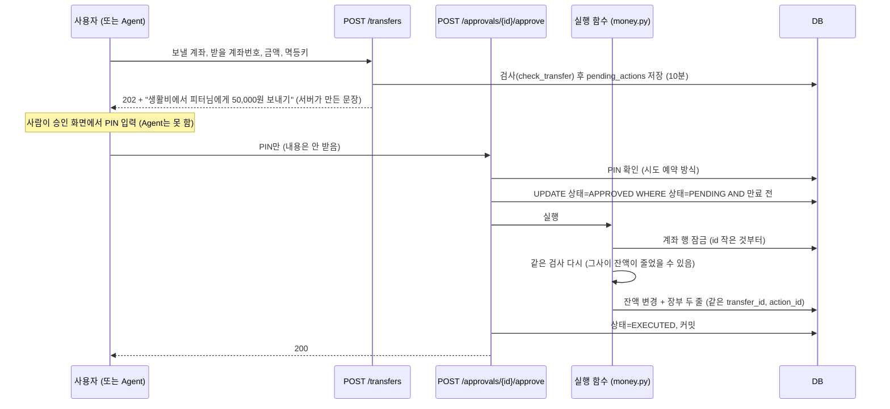

# 4. 돈이 움직이는 흐름 (이체·승인·실행 함수)

> **이체 요청은 돈을 옮기지 않고 "승인 대기"만 만든다. 사용자가 PIN으로 승인하면 실행 함수 하나가 계좌를 순서대로 잠그고, 같은 검사를 다시 하고, 잔액과 장부 두 줄을 한 트랜잭션으로 쓴다.**

결정 원문: [ADR 0004 승인은 서버가 강제](../decisions/0004-agent-integration.md), [ADR 0007 실행 지점 하나](../decisions/0007-money-execution-and-budget-guard.md), [ERD 승인·실행 규칙](../ERD.md#승인실행-규칙-adr-0004)

## 코드 위치

| 단계 | API | 코드 |
|---|---|---|
| 이체 요청 → 승인 대기 | `POST /transfers` | `transfers/service.py` `request_transfer` |
| 승인 화면 | `GET /approvals`, `/{id}` | `approvals/service.py` |
| PIN 승인 → 실행 | `POST /approvals/{id}/approve` | `approvals/service.py` `approve` |
| 거절 | `POST /approvals/{id}/reject` | `approvals/service.py` `reject` |
| **검사 (요청·실행 공용)** | — | `accounts/money.py` `check_transfer` |
| **실행 함수** | — | `accounts/money.py` `execute_transfer` |
| 승인 대상별 실행기 | — | `approvals/service.py` `EXECUTORS`: `TRANSFER` → `run_transfer`, `OPEN_DEPOSIT` → `accounts/service.py` `run_open_deposit` |

## 전체 흐름



## 승인 대상이 늘어나는 방법

```python
EXECUTORS = {"TRANSFER": run_transfer, "OPEN_DEPOSIT": run_open_deposit}
```
승인 API는 하나이고, `action_type`에 맞는 실행기를 같은 트랜잭션 안에서 부릅니다. 예금 개설은 "계좌 생성 + 맡길 돈 이동(`INTERNAL_OUT/IN`, 메모 `예금 가입`)"이 한 번에 됩니다. 앞으로 카드 정지 해제, 대출 실행도 실행기 한 줄씩 추가합니다. 실행기에서 업무 오류가 나면 `TransferRejected`로 바꿔 `FAILED`로 남기고, 그 밖의 오류는 트랜잭션 전체가 되돌아가 `PENDING`으로 남습니다.

## 핵심 규칙과 코드

**1. 승인은 PIN만 받는다**
```python
class ApproveRequest(BaseModel):
    pin: str = Field(pattern=r"^\d{6}$")    # 금액·받는 사람은 받지 않음
```
실행할 내용은 요청 때 저장한 `payload`만 씁니다. 승인 화면에서 "5만 원"을 보고 승인했는데 다른 값이 실행되는 바꿔치기를 막습니다. 화면 문장(`summary`)도 서버가 `payload`로 만들고, 받는 사람 이름은 한글·영문만 허용해서 이름으로 금액을 꾸밀 수 없습니다.

**2. 두 번 눌러도 한 번만**
```python
update(PendingAction).where(..., status == "PENDING", expires_at > now).values(status="APPROVED").returning(...)
```
"대기 중이고 만료 전"일 때만 바뀌는 한 문장이라, 동시에 두 번 와도 하나만 통과합니다. 나머지는 `409 ACTION_NOT_PENDING`.

왜 한 번만 통과하나요? PostgreSQL의 기본 격리 수준(READ COMMITTED)에서 두 UPDATE가 같은 행을 바꾸려 하면 뒤의 것은 앞의 트랜잭션이 끝날 때까지 기다리고, 끝난 뒤 **조건을 다시 확인**합니다. 그때는 이미 `APPROVED`라서 `status = 'PENDING'` 조건에 맞지 않아 0행이 바뀝니다. 이 "한 번만"은 `test_claim_succeeds_only_once`가 저장소 함수를 두 번 불러서 확인합니다.

**3. 검사를 두 번 한다**

| 언제 | 왜 |
|---|---|
| 요청 때 (`request_transfer`) | 잔액·한도가 안 되면 바로 알려 주려고 |
| 실행 때 (`execute_transfer`, 잠근 뒤) | 요청과 승인 사이 몇 분 동안 다른 출금이 있었을 수 있어서. **진짜로 지키는 검사** |

두 번 모두 같은 함수 `check_transfer`를 써서 규칙이 어긋나지 않습니다. 실행 때 막히면 돈은 안 움직이고, 승인 대기를 `FAILED` + 이유로 **커밋한 뒤** 400을 줍니다.

**4. 잠금 순서**
```python
select(Account).where(Account.account_id.in_({from_id, to_id}))
              .order_by(Account.account_id).with_for_update()
```
A→B와 B→A 이체가 동시에 오면, 각자 자기 출금 계좌부터 잠그면 서로를 기다리다 멈춥니다(교착). 둘 다 **id 작은 계좌부터** 잠그면 한쪽이 먼저 끝납니다.

**5. 장부 두 줄**

| 계좌 | tx_type | amount | balance_after | counterparty |
|---|---|---|---|---|
| 보낸 쪽 | `TRANSFER_OUT` | −50,000 | 950,000 | 피터 |
| 받은 쪽 | `TRANSFER_IN` | +50,000 | 50,000 | 토니 |

두 줄은 같은 `transfer_id`로 묶이고, `action_id`로 어느 승인이 만든 것인지 따라갈 수 있습니다. 금액 부호와 거래 종류가 맞지 않으면 DB CHECK가 막습니다. 내 계좌끼리(내 적금 납입, 예금 가입)는 `INTERNAL_OUT/IN`이고 이체 한도를 적용하지 않습니다. 예금 계좌로 들어가는 건 **가입할 때 한 번만**(`opening_deposit=True`)이고, 그 뒤 이체로는 넣을 수 없습니다.

**6. 한도**
- 1회 한도, 1일 한도(오늘 **한국 날짜**에 남에게 보낸 `TRANSFER_OUT` 합계)
- 기본값 1회 100만, 1일 500만 (ADR 0008)

**7. 멱등키**
같은 `idempotency_key`로 같은 내용이 다시 오면 새로 만들지 않고 처음 것을 돌려줍니다(200). 키는 **사용자마다 따로** unique입니다(`UNIQUE(user_id, idempotency_key)`).

| 상황 | 응답 |
|---|---|
| 같은 키, 같은 내용, 처음 것이 이미 저장됨 | `200` + 처음 승인 대기 |
| 같은 키, 다른 내용(금액·메모 등) | `409 IDEMPOTENCY_KEY_REUSED` |
| 같은 키가 **동시에** 두 번 (둘 다 아직 저장 전) | 하나는 `202`, 다른 하나는 `409 DUPLICATE_REQUEST` (unique 제약이 막음) |

네트워크가 끊겨 앱이 다시 보내도 이체가 두 번 생기지 않습니다.

## 면접 예상 질문

**Q. Agent가 사용자 토큰을 가지고 있으면 이체를 할 수 있지 않나요?**
A. 이체 요청은 할 수 있지만 **토큰만으로는 실행이 안 됩니다.** 요청은 승인 대기만 만들고, 승인은 거래 PIN을 요구합니다. PIN을 바꾸려면 비밀번호가 필요하고, PIN 추측은 동시에 보내도 5번에서 잠깁니다. 정확히 말하면 서버가 보장하는 것은 "**PIN을 아는 사람이 승인해야 실행**"입니다. 사용자가 Agent에게 PIN을 알려 주면 막을 수 없어서, 2차로 패스키(기기의 지문·얼굴 인증)를 붙일 계획이고, Agent 도구 목록에서 승인 API를 빼는 것은 Agent를 만들 때 합니다(ADR 0004, 0005).

**Q. 실행 함수를 왜 하나로 모았나요?**
A. 이체·카드 결제·대출 상환·예산 저축 이체가 각자 잔액을 바꾸면, 잠금 순서·재검사·장부 기록·예산 검사를 여러 곳에 똑같이 써야 하고 한 곳은 꼭 빠집니다. 한 함수로 모으면 그 규칙을 한 번만 지키면 되고, 나중에 예산 가드도 그 앞에 한 번만 끼우면 됩니다(ADR 0007). 지금 있는 것은 이체(`execute_transfer`)이고, 카드·대출·예산은 그 기능을 만들 때 같은 함수를 지나게 합니다. **예외 하나**: 데모 데이터를 넣는 `seed.py`는 초기 잔액을 직접 넣습니다(코드에 shortcut 주석).

**Q. 승인하고 실행하는 중에 서버가 죽으면요?**
A. 승인 상태 변경과 잔액·장부 변경이 **같은 트랜잭션**이라 통째로 되돌아가서 `PENDING`으로 남습니다. "승인됐는데 돈은 안 간" 상태가 생기지 않습니다.

**Q. 잔액을 바꿀 때 동시성은 어떻게 지키나요?**
A. 계좌 행을 `FOR UPDATE`로 잠그고 잠근 뒤의 최신 값으로 다시 검사합니다(`populate_existing`). 잠금은 id 오름차순으로 해서 교착을 막습니다. **솔직히 말하면 이 잠금은 아직 테스트로 확인하지 못했습니다.** 테스트가 SQLite로 돌고 SQLite는 `FOR UPDATE`를 무시하기 때문입니다. 확인한 것은 "두 번 승인"을 막는 조건부 UPDATE(`test_claim_succeeds_only_once`)이고, 다음 단계는 CI에서 PostgreSQL로 동시 출금 테스트를 돌리는 것입니다.
