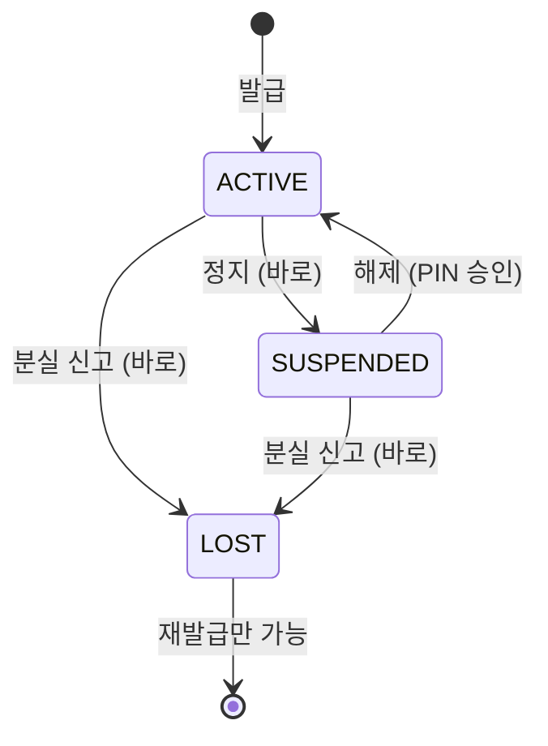

# 6. 카드 (발급·정지·해제)

> **신용·체크카드는 한 테이블이고, 번호는 Luhn 검증 숫자가 붙은 16자리, 응답에는 가린 번호만 나간다. 정지·분실 신고는 바로, 정지 해제는 PIN 승인이다. 결제는 다음 PR에서 실행 함수를 거친다.**

결정 원문: [ADR 0009](../decisions/0009-card-policy.md), [ADR 0003](../decisions/0003-db-redesign.md)

## 코드 위치

| 기능 | API | 코드 |
|---|---|---|
| 카드 상품 목록 | `GET /products/cards?type=` | `cards/router.py` `products_router` |
| 발급 | `POST /cards` | `cards/service.py` `issue` |
| 내 카드·상세 | `GET /cards`, `/cards/{id}` | `cards/service.py` `list_mine`, `get_mine` |
| 정지·분실 신고 (바로) | `POST /cards/{id}/suspend` | `cards/service.py` `suspend` |
| 정지 해제 (승인) | `POST /cards/{id}/unsuspend` → `/approvals/{id}/approve` | `cards/service.py` `request_unsuspend`, 실행기 `run_unsuspend_card` |
| 카드번호 | — | `cards/card_number.py` |

## 카드번호: 9410 T PP NNNNNNNN C

```
9410 2 01 00000001 7
│    │ │  │        └ Luhn 검증 숫자 (한 자리 오타를 잡음)
│    │ │  └ 상품별 일련번호
│    │ └ 카드 상품 코드
│    └ 1 신용 / 2 체크
└ 데모 발급사 번호
응답: 9410-20**-****-0017
```

**Luhn 계산**: 오른쪽부터 한 칸 걸러 두 배(9를 넘으면 9를 뺌) 하고 모두 더해서, 합이 10의 배수가 되게 끝자리를 정합니다. 실제 카드번호도 같은 규칙이라 `4111 1111 1111 1111`(유명한 테스트 번호)도 통과합니다.

## 상태 흐름



- **안전해지는 쪽(정지·분실)은 바로, 위험해지는 쪽(해제)은 승인**: 이체·예산 설정과 같은 원칙입니다(ADR 0004, 0007).
- 해제 승인을 기다리는 동안 분실 신고가 되면, 승인해도 풀리지 않습니다(실행기가 상태를 다시 봄 → `FAILED`).

## 한 테이블에 신용·체크

| 칸 | 체크 | 신용 |
|---|---|---|
| `daily_limit` | 100만 | 100만 |
| `monthly_limit` | 없음 | 300만 (≥ 1일 한도) |
| `payment_day` | 없음 | 1~28일 (기본 14일) |

"신용이면 있음, 체크면 없음"을 CHECK가 강제합니다. 계좌의 이체 한도와 같은 방식이고, NULL이면 CHECK가 통과해 버려서 `IS NOT NULL`을 같이 적었습니다.

## 면접 예상 질문

**Q. 카드번호를 왜 응답에서 가리나요?**
A. 카드번호는 결제에 쓰이는 정보라 응답·로그·Agent 대화에 남으면 유출 경로가 됩니다. 화면에 필요한 건 "어느 카드인지" 구분하는 것이라 앞 6자리와 뒤 4자리면 충분합니다. 전체 번호는 DB에만 둡니다.

**Q. Luhn은 왜 넣었나요? 보안 기능인가요?**
A. 보안이 아니라 **입력 오류 검출**입니다. 한 자리를 잘못 쓰거나 이웃한 두 자리를 바꿔 쓰면 대부분 검증에 실패합니다. 카드번호를 손으로 입력하는 화면에서 서버까지 가기 전에 오타를 잡을 수 있습니다.

**Q. 분실 신고를 왜 승인 없이 바로 하나요? 다른 사람이 내 카드를 정지할 수 있지 않나요?**
A. 로그인한 본인(또는 본인 토큰을 가진 Agent)만 할 수 있고, 최악의 경우 카드가 정지되는 것이라 돈이 나가지 않습니다. 반대로 승인을 요구하면 PIN을 입력하는 동안 잃어버린 카드가 결제될 수 있습니다. 그래서 "안전해지는 쪽은 바로"입니다. 대신 해제는 PIN이 필요해서, 토큰만 가진 사람이 정지를 풀고 결제할 수는 없습니다.
