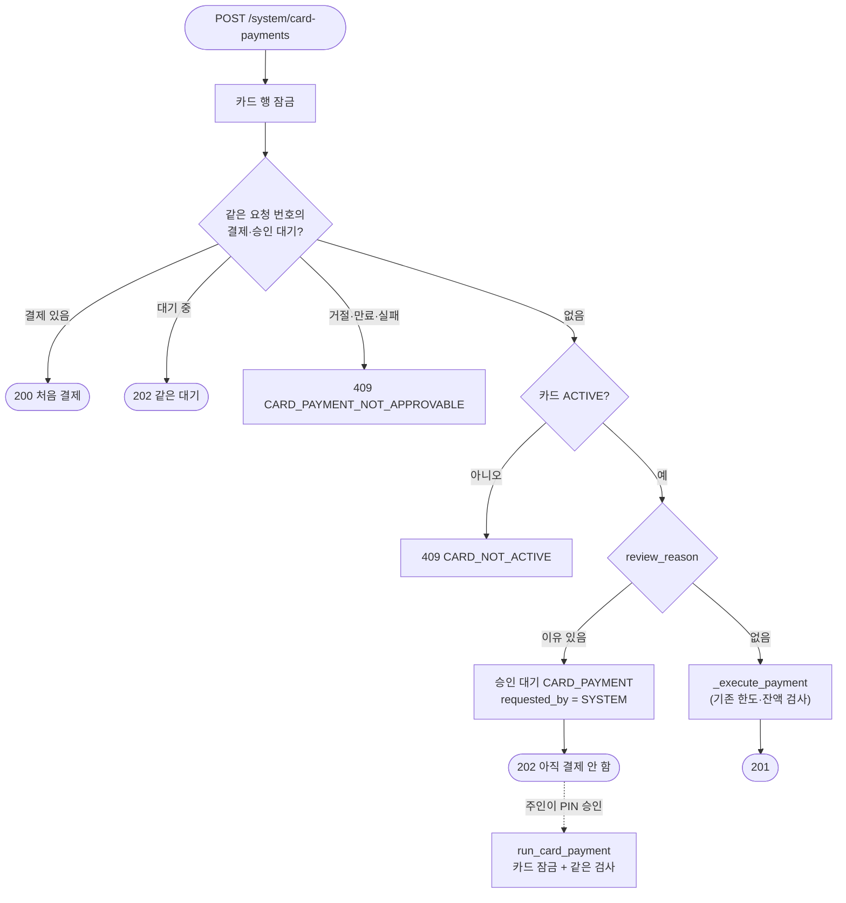

# 7. 카드 결제 (결제·취소·사용내역·한도)

> **결제는 카드 행을 잠그고 한 줄로 처리한다. 체크카드는 실행 함수로 계좌에서 바로 빼고, 신용카드는 "안 갚은 금액"으로 기록만 한다. 한도는 저장하지 않고 매번 합계로 계산한다.**

결정 이유: [ADR 0010](../decisions/0010-card-payments.md)

## 코드 위치

| 하는 일 | API | 코드 |
|---|---|---|
| 결제 (가맹점 흉내) | `POST /cards/{id}/payments` | `cards/service.py` `pay` |
| 취소 (전액) | `POST /cards/{id}/transactions/{tx}/cancel` | `cards/service.py` `cancel` |
| 사용내역 | `GET /cards/{id}/transactions` | `cards/service.py` `list_txs` |
| 한도와 쓴 금액 | `GET /cards/{id}/limits` | `cards/service.py` `limits` |
| 체크카드 출금·환불 | (내부) | `accounts/money.py` `execute_card_ledger` |
| 합계 쿼리 | (내부) | `cards/repository.py` `spent_since`, `unpaid_credit` |
| 테이블 | | `cards/models.py` `CardTransaction`, 마이그레이션 `c4f8a2d6e1b7` |

## 요청 흐름


## 핵심 코드

```python
async with db.begin():
    card = await self._my_card(db, user_id, card_id, lock=True)   # 1. 카드부터 잠금
    existing = await card_repository.find_tx_by_key(...)          # 2. 잠근 뒤에 요청 번호 확인
    ...
    used_today = await card_repository.spent_since(db, card_id, 오늘_0시)  # 3. 합계는 계산
```

순서가 중요합니다. 요청 번호를 **잠그기 전에** 보면, 같은 요청이 동시에 두 번 와서 둘 다 "처음 보는 번호"라고 판단할 수 있습니다.

## 왜 이렇게 했나

- **카드 행을 잠근다**: 체크카드는 계좌 행을 잠그니 잔액은 안전하지만, 신용카드는 계좌를 건드리지 않습니다. 카드 행을 잠그면 체크·신용 모두 "같은 카드의 결제는 한 번에 하나"가 됩니다. 다른 카드끼리는 서로 기다리지 않습니다.
- **잠금 순서는 카드 → 계좌**: 이체는 계좌만 잠그고 카드를 잠그지 않아서, 서로 반대 순서로 기다리는 교착이 생기지 않습니다.
- **누적액을 저장하지 않는다**: 저장하면 결제·취소·청구마다 같이 고쳐야 하고, 하나라도 빠뜨리면 한도가 틀어집니다. 합계 쿼리는 `(card_id, approved_at)` 인덱스를 탑니다.
- **신용 한도는 안 갚은 금액**: 실제 카드처럼 대금을 내면 한도가 돌아옵니다. 그래서 컬럼 이름을 `monthly_limit`에서 `credit_limit`으로 바꿨습니다.
- **환불은 쓴 업종 그대로**: "카페·간식" 결제를 취소하면 환불도 "카페·간식"으로 기록합니다. 예산 분석에서 그 업종 지출이 줄어듭니다.
- **CHECK로 체크·신용 구분**: 체크카드 사용내역은 장부 줄(`account_tx_id`)이 있고 청구 상태가 없습니다. 신용카드는 그 반대입니다. DB가 이것을 강제합니다.

## 면접 예상 질문

**Q. 같은 결제 요청이 두 번 오면요?**
A. 카드마다 요청 번호가 unique입니다. 카드 행을 잠근 뒤 번호를 찾아서, 있으면 처음 결과를 200으로 돌려줍니다. 번호는 같은데 금액이 다르면 409입니다.

**Q. 결제에 PIN이 없으면 Agent가 마음대로 결제할 수 있지 않나요?**
A. 결제 API는 가맹점을 흉내 내는 입구라서 Agent·MCP 도구 목록에 넣지 않습니다. 이체처럼 돈을 "보내는" 도구는 승인 대기만 만듭니다(ADR 0004). 다만 이것은 도구 목록이 지키는 규칙이고, 서버가 호출한 쪽을 따로 구분하지는 않습니다.

**Q. 1일 한도 100만 원에서 90만 원을 쓰고 취소하면요?**
A. 취소한 결제는 합계에서 빠지므로 다시 100만 원까지 쓸 수 있습니다. 실제 카드사와 같습니다.

**Q. 신용카드 결제는 왜 계좌 장부에 안 남나요?**
A. 돈이 아직 안 나갔기 때문입니다. 대금 출금일에 `CARD_BILL` 한 줄로 나갑니다. 예산에서는 쓴 순간(`card_transactions`)에 세고, `CARD_BILL`은 세지 않아서 두 번 빠지지 않습니다.

## 결제 보호 (ADR 0023)

> **보호를 켠 사용자의 결제는 가맹점 경로(`/system/card-payments`)로만 들어온다. 규칙에 걸리면 돈을 움직이지 않고 승인 대기(`CARD_PAYMENT`)를 만들고, 주인이 PIN으로 승인할 때 기존 결제 코드로 실행한다.**

결정 이유: [ADR 0023](../decisions/0023-card-protection-and-benefits.md)

### 코드 위치

| 하는 일 | API | 코드 |
|---|---|---|
| 보호 설정 조회·변경 (PIN) | `GET`·`PUT /cards/protection` | `cards/protection.py` `get_settings`, `update_settings` |
| 스마트폰 위치 기록 | `PUT /cards/protection/location` | `cards/protection.py` `record_location` |
| 은행 화면 활동 기록 | `PUT /cards/protection/activity` | `cards/protection.py` `record_activity` |
| 가맹점 결제 (서버 키) | `POST /system/card-payments/{card_id}` | `cards/router.py` `merchant_pay` → `cards/service.py` `pay` |
| 확인이 필요한지 판단 | (내부) | `cards/protection.py` `review_reason` |
| 승인 뒤 결제 실행 | `POST /approvals/{id}/approve` | `cards/service.py` `run_card_payment` (`approvals/service.py` `EXECUTORS`) |
| 두 좌표 사이 거리 | (내부) | `core/geo.py` `distance_m` (하버사인) |
| 날짜별 사용내역 | `GET /cards/{id}/transactions?payment_date=` | `cards/service.py` `list_txs` |
| 시연 화면 | `/app/protection.html` | `frontend/protection.mjs` (위치 5분마다, 터치 때 활동, 15초마다 승인 대기 새로고침) |
| 저장 칸 | | `users.card_protection` JSON, `pending_actions.requested_by`에 `SYSTEM`, 마이그레이션 `0910c4d93eb1` |

### 요청 흐름



`review_reason`의 규칙:

| 결제 | 확인이 필요한 경우 |
|---|---|
| 오프라인 (위치 확인 켬) | 15분 안 위치 없음 / 위치 정확도 2km 초과 / (거리 − 정확도 − 800m) > 10km |
| 온라인 (활동시간 정함) | 50만 원 이상인데 최근 30일 승인 내역에 없는 가맹점 → 무조건 확인 |
| | 그 밖: 한국 시간으로 활동시간 밖이고, 5분 안 화면 활동·스마트폰 이동도 없음 |

### 핵심 코드

```python
# cards/service.py pay: 잠근 뒤 재전송 확인 → 판단 → 대기 또는 결제
if isinstance(data, MerchantPayment) and (reason := await review_reason(db, card_id, state, data, now)):
    action = PendingAction(user_id=card.user_id, action_type="CARD_PAYMENT", requested_by="SYSTEM",
                           idempotency_key=key, expires_at=now + APPROVAL_TTL, payload=payload, summary=...)
    return await approval_repository.save(db, action), True
return await self._execute_payment(db, card, data), True
```

승인 대기의 키는 `card-review-` + sha256(카드 id:요청 번호)입니다. 가맹점이 같은 번호로 다시 보내면 같은 대기를 찾습니다.

### 왜 이렇게 했나

- **기존 승인 경로를 그대로 쓴다**: 만료(10분), 조건부 UPDATE로 한 번만 승인, 실행 직전 재검사가 이미 있습니다. 결제 실행도 기존 `_execute_payment`를 나눠서 바로 결제와 승인 뒤 결제가 같은 코드를 지납니다.
- **보호를 켜면 주인 경로를 막는다**: `/cards/{id}/payments`는 주인 토큰으로 부르므로, 열어 두면 보호를 건너뛸 수 있습니다(`409 MERCHANT_CHANNEL_REQUIRED`).
- **위치는 한 건만, 반올림해서**: 판단에는 최근 위치 하나면 됩니다. 0.01도(약 1km)로 반올림하고 그 오차를 800m 여유로 감안합니다. 위치 확인을 끄면 지웁니다.
- **이동 신호**: 15분 안의 두 위치가 (거리 − 두 정확도 − 800m) > 1km이면 `movement_at`을 남깁니다. 움직이는 사람이 휴대폰을 들고 있다는 신호라 온라인 결제 확인을 대신합니다. 오프라인 위치 검사는 따로 합니다.
- **활동 시각은 서버 시간**: 브라우저가 시각을 정하지 못하게 서버가 `now`를 씁니다. 1분 안에 다시 오면 저장하지 않습니다.

### 면접 예상 질문

**Q. 의심 결제를 왜 거절하지 않고 승인 대기로 두나요?**
A. 출장·여행처럼 주인이 정말 결제하는 경우가 있어서입니다. 거절하면 결제를 다시 해야 하지만, 승인 대기면 주인이 PIN 한 번으로 통과시킵니다. 돈은 승인 전까지 움직이지 않습니다.

**Q. 승인 대기 중에 카드를 정지하면요?**
A. 승인 때 카드 상태를 다시 봐서 `400 CARD_NOT_ACTIVE`, 대기는 `FAILED`로 끝납니다. 잔액은 그대로입니다.

**Q. 브라우저가 보낸 위치를 믿어도 되나요?**
A. 아니요. 지금은 로그인한 은행 화면이 보내는 확인 신호로만 씁니다. 코드에 `shortcut` 주석으로 남겼고, 실결제망에 붙이려면 기기 인증이 필요합니다(ADR 0023 감수할 점).

**Q. 가맹점이 202를 받고 같은 결제를 계속 보내면요?**
A. 같은 요청 번호면 같은 승인 대기를 202로 돌려줍니다. 승인돼 결제됐으면 그 결제를 200으로, 거절·만료됐으면 409로 답합니다. 결제는 한 번만 됩니다.
