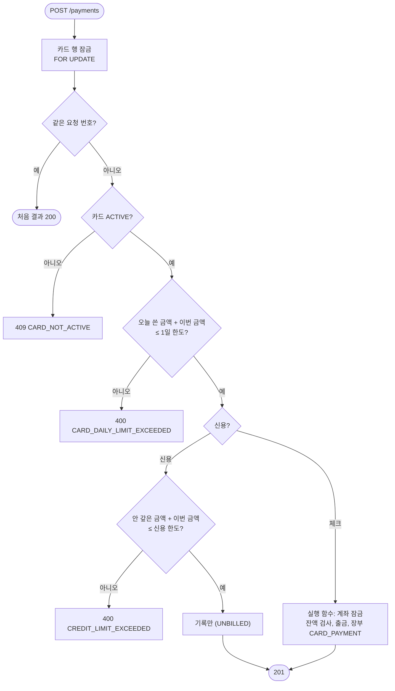

# 7. 카드 결제 (결제·취소·사용내역·한도)

> **결제는 카드 행을 잠그고 한 줄로 처리한다. 체크카드는 실행 함수로 계좌에서 바로 빼고, 신용카드는 "안 갚은 금액"으로 기록만 한다. 한도는 저장하지 않고 매번 합계로 계산한다.**

결정 이유: [ADR 0010](../decisions/0010-card-payments.md)

## 코드 위치

| 하는 일 | API | 코드 |
|---|---|---|
| 결제 (가맹점 흉내) | `POST /cards/{id}/payments` | `cards/service.py` `pay` |
| 취소 (전액) | `POST /cards/{id}/transactions/{tx}/cancel` | `cards/service.py` `cancel` |
| 사용내역 | `GET /cards/{id}/transactions` | `cards/service.py` `list_txs` |
| 한도와 쓴 금액 | `GET /cards/{id}/limits` | `cards/service.py` `limits` |
| 체크카드 출금·환불 | (내부) | `accounts/money.py` `execute_card_ledger` |
| 합계 쿼리 | (내부) | `cards/repository.py` `spent_since`, `unpaid_credit` |
| 테이블 | | `cards/models.py` `CardTransaction`, 마이그레이션 `c4f8a2d6e1b7` |

## 요청 흐름



## 핵심 코드

```python
async with db.begin():
    card = await self._my_card(db, user_id, card_id, lock=True)   # 1. 카드부터 잠금
    existing = await card_repository.find_tx_by_key(...)          # 2. 잠근 뒤에 요청 번호 확인
    ...
    used_today = await card_repository.spent_since(db, card_id, 오늘_0시)  # 3. 합계는 계산
```

순서가 중요합니다. 요청 번호를 **잠그기 전에** 보면, 같은 요청이 동시에 두 번 와서 둘 다 "처음 보는 번호"라고 판단할 수 있습니다.

## 왜 이렇게 했나

- **카드 행을 잠근다**: 체크카드는 계좌 행을 잠그니 잔액은 안전하지만, 신용카드는 계좌를 건드리지 않습니다. 카드 행을 잠그면 체크·신용 모두 "같은 카드의 결제는 한 번에 하나"가 됩니다. 다른 카드끼리는 서로 기다리지 않습니다.
- **잠금 순서는 카드 → 계좌**: 이체는 계좌만 잠그고 카드를 잠그지 않아서, 서로 반대 순서로 기다리는 교착이 생기지 않습니다.
- **누적액을 저장하지 않는다**: 저장하면 결제·취소·청구마다 같이 고쳐야 하고, 하나라도 빠뜨리면 한도가 틀어집니다. 합계 쿼리는 `(card_id, approved_at)` 인덱스를 탑니다.
- **신용 한도는 안 갚은 금액**: 실제 카드처럼 대금을 내면 한도가 돌아옵니다. 그래서 컬럼 이름을 `monthly_limit`에서 `credit_limit`으로 바꿨습니다.
- **환불은 쓴 업종 그대로**: "카페·간식" 결제를 취소하면 환불도 "카페·간식"으로 기록합니다. 예산 분석에서 그 업종 지출이 줄어듭니다.
- **CHECK로 체크·신용 구분**: 체크카드 사용내역은 장부 줄(`account_tx_id`)이 있고 청구 상태가 없습니다. 신용카드는 그 반대입니다. DB가 이것을 강제합니다.

## 면접 예상 질문

**Q. 같은 결제 요청이 두 번 오면요?**
A. 카드마다 요청 번호가 unique입니다. 카드 행을 잠근 뒤 번호를 찾아서, 있으면 처음 결과를 200으로 돌려줍니다. 번호는 같은데 금액이 다르면 409입니다.

**Q. 결제에 PIN이 없으면 Agent가 마음대로 결제할 수 있지 않나요?**
A. 결제 API는 가맹점을 흉내 내는 입구라서 Agent·MCP 도구 목록에 넣지 않습니다. 이체처럼 돈을 "보내는" 도구는 승인 대기만 만듭니다(ADR 0004). 다만 이것은 도구 목록이 지키는 규칙이고, 서버가 호출한 쪽을 따로 구분하지는 않습니다.

**Q. 1일 한도 100만 원에서 90만 원을 쓰고 취소하면요?**
A. 취소한 결제는 합계에서 빠지므로 다시 100만 원까지 쓸 수 있습니다. 실제 카드사와 같습니다.

**Q. 신용카드 결제는 왜 계좌 장부에 안 남나요?**
A. 돈이 아직 안 나갔기 때문입니다. 대금 출금일에 `CARD_BILL` 한 줄로 나갑니다. 예산에서는 쓴 순간(`card_transactions`)에 세고, `CARD_BILL`은 세지 않아서 두 번 빠지지 않습니다.
