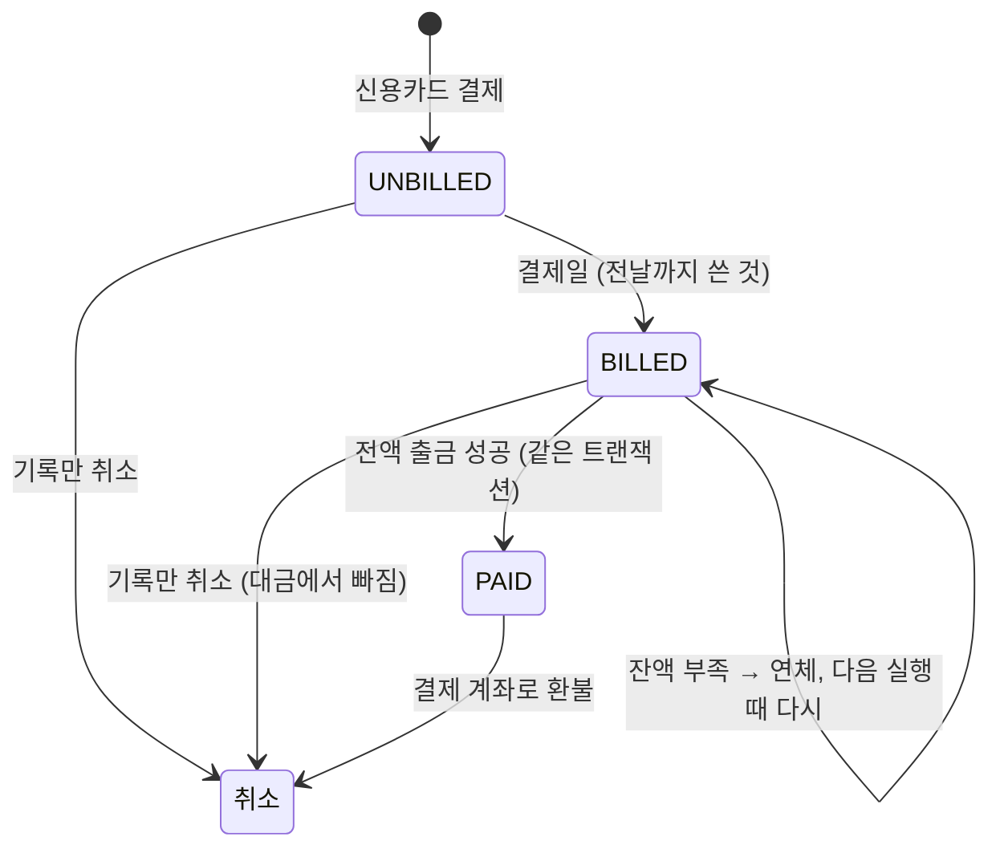

# 8. 신용카드 대금 출금

> **결제일에 시스템 API가 "전날까지 쓴 것"을 묶어(BILLED) 결제 계좌에서 전액 출금하고 PAID로 바꾼다. 잔액이 모자라면 BILLED(연체)로 남기고, 연체가 풀릴 때까지 그 카드는 결제할 수 없다.**

결정 이유: [ADR 0011](../decisions/0011-card-bills.md)

## 코드 위치

| 하는 일 | API | 코드 |
|---|---|---|
| 대금 출금 실행 | `POST /system/card-bills/run?run_date=` (`X-System-Key`) | `cards/service.py` `run_bills` |
| 서버 키 확인 | (모든 `/system/*`) | `core/dependencies.py` `require_system_key` |
| 대상 카드, 묶기, 묶인 것 찾기 | (내부) | `cards/repository.py` `cards_to_bill`, `bill`, `find_billed` |
| 연체면 결제 막기 | `POST /cards/{id}/payments` | `cards/service.py` `pay` (`CARD_OVERDUE`) |
| 출금 | (내부) | `accounts/money.py` `execute_card_ledger` (`CARD_BILL`) |

## 사용분 하나의 상태



`BILLED → PAID`는 같은 트랜잭션 안에서 일어납니다. 그래서 DB에 `BILLED`로 남아 있는 것은 **연체뿐**이고, `has_overdue`는 `BILLED`가 있는지만 봅니다.

## 실행 한 번의 흐름

```text
run_bills(2030-01-14)
  ├ 트랜잭션: 대상 카드 목록 = 결제일이 14일인 신용카드 + 연체가 있는 카드
  └ 카드마다 트랜잭션 하나
       ├ 카드 행 잠금 (결제·취소와 같은 잠금)
       ├ 결제일이면: 1월 14일 0시(한국) 전 UNBILLED → BILLED
       ├ BILLED 합계 = 0 이면 끝
       ├ 실행 함수로 출금 (CARD_BILL)  ── 실패(잔액 부족) → BILLED 그대로 커밋, 연체
       └ 성공 → 사용분 PAID, bill_tx_id = 출금 줄
```

## 왜 이렇게 했나

- **스케줄러 대신 API**: 날짜를 넣어 부를 수 있어서 "1월 14일 대금 출금"을 오늘 시연·테스트할 수 있습니다. 매일 부르는 일은 cron 같은 바깥 도구에 맡깁니다.
- **다시 불러도 안전**: 이미 `PAID`인 것은 묶이지 않습니다. 같은 날 두 번 불러도 두 번째는 0원입니다.
- **카드마다 트랜잭션**: 한 사람의 잔액 부족이 다른 사람의 대금 출금을 되돌리지 않습니다.
- **카드 행을 잠근다**: 묶는 동안 결제가 끼어들면, 방금 쓴 것이 이번 대금에 들어갈지가 그때그때 달라집니다. 결제와 같은 잠금을 쓰면 한 번에 하나만 처리됩니다.
- **전액 아니면 출금 안 함**: 부분 출금을 하려면 사용분마다 얼마를 갚았는지 적어야 해서 테이블이 커집니다.

## 면접 예상 질문

**Q. 대금 출금 API를 누가 막 부르면요?**
A. 사용자 토큰으로는 부를 수 없고, `.env`의 서버 키(32자 이상)가 맞아야 합니다. 키는 `secrets.compare_digest`로 비교해서 응답 시간으로 키를 알아낼 수 없습니다. 키를 설정하지 않으면 API가 꺼집니다. 키가 새더라도 정해진 대금이 본인 계좌에서 나갈 뿐 돈이 남에게 가지는 않습니다.

**Q. 서버가 출금 도중에 죽으면요?**
A. 카드 하나의 처리(묶기, 출금, PAID 표시)가 트랜잭션 하나입니다. 통째로 되돌아가 `UNBILLED`로 남고, 다시 부르면 처음부터 합니다.

**Q. 결제일 당일 아침에 쓴 것은요?**
A. 결제일 0시 전까지 쓴 것만 묶어서 다음 달 대금에 들어갑니다. 테스트 `test_only_on_payment_day_and_only_before_it`이 확인합니다.

**Q. 연체 중에 결제를 취소하면요?**
A. 아직 돈이 안 나갔으니 기록만 취소하고 대금에서 빠집니다. 이미 낸 결제를 취소하면 결제 계좌로 환불합니다.
