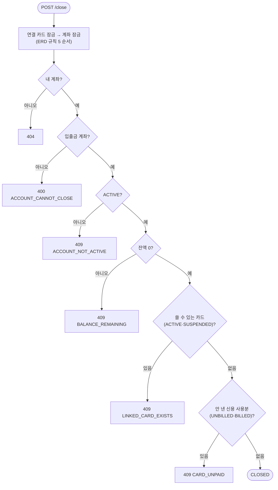

# 9. 계좌 해지와 해지 뒤 환불

> **잔액이 0이고, 쓸 수 있는 카드나 안 낸 카드 대금이 연결돼 있지 않은 입출금 계좌만 바로 해지한다. 해지 뒤 들어온 결제 취소는 "환불 대기"로 두고, 상담원이 고객을 확인한 뒤 다른 입출금 계좌로 보낸다.**

결정 이유: [ADR 0012](../decisions/0012-account-close.md)

## 코드 위치

| 하는 일 | API | 코드 |
|---|---|---|
| 해지 | `POST /accounts/{id}/close` | `accounts/service.py` `close` |
| 해지 뒤 취소 → 환불 대기 | `POST /cards/{id}/transactions/{tx}/cancel` | `cards/service.py` `cancel`, `CardTransaction.refund_pending` |
| 환불 대기 목록 (상담원) | `GET /system/card-refunds` | `cards/service.py` `list_pending_refunds` |
| 다른 계좌로 환불 (상담원) | `POST /system/card-refunds/{card_tx_id}` | `cards/service.py` `refund_to` |

## 해지 검사 순서



## 환불 대기는 칸이 아니라 계산

`refund_pending`은 테이블 칸이 아니라 모델의 계산 값입니다.

```python
@property
def refund_pending(self) -> bool:
    paid_out = self.account_tx_id is not None or self.billing_status == "PAID"  # 돈이 나간 결제
    return self.status == "CANCELED" and paid_out and self.refund_tx_id is None  # 취소됐는데 환불 줄이 없음
```

"돈이 나갔는데 취소됐고, 환불 줄이 아직 없다"가 곧 환불 대기입니다. 새 상태값을 만들면 마이그레이션과 CHECK가 늘고, 칸과 실제 상태가 어긋날 수 있습니다.

## 왜 이렇게 했나

- **잔액 0일 때만, PIN 없이**: 돈이 움직이지 않으니 승인이 필요 없습니다(ERD "안전한 쪽은 바로"). 남은 돈을 옮기는 이체는 이미 PIN을 받습니다.
- **카드를 먼저 잠근다**: 체크카드 결제는 카드 → 계좌 순으로 잠급니다. 해지도 같은 순서로 잠가야 서로 기다리다 멈추는(교착) 일이 없습니다.
- **카드 검사는 계좌를 잠근 뒤에**: 카드 발급은 결제 계좌를 잠급니다. 해지가 계좌를 잠근 다음 카드를 세면, 그 직전에 발급된 카드도 보입니다.
- **환불을 자동으로 옮기지 않는다**: 고객이 모르는 계좌로 돈이 가면 안 됩니다. 상담원이 고객에게 확인하고 보냅니다.

## 면접 예상 질문

**Q. 해지하는 순간 카드가 발급되면요?**
A. 발급은 결제 계좌 행을 잠그고 `ACTIVE`인지 봅니다. 해지도 그 계좌 행을 잠근 뒤에 연결 카드를 셉니다. 발급이 먼저 끝나면 해지가 새 카드를 보고 막히고, 해지가 먼저 끝나면 발급이 `CLOSED`를 보고 거절합니다.

**Q. 해지한 계좌로 환불이 오면 돈은 어디 있나요?**
A. 아직 은행이 고객에게 돌려주지 않은 상태로 남습니다. 결제 기록은 `CANCELED`이고 `refund_pending`이 `true`입니다. 상담원 목록(`GET /system/card-refunds`)에 뜨고, 고객이 원하는 다른 입출금 계좌로 보내면 `REFUND` 줄이 생깁니다. 같은 건을 두 번 보내지 않도록 카드 행을 잠그고 다시 확인합니다.

**Q. 상담원 API를 왜 서버 키로 했나요?**
A. 이 앱에는 직원 계정이 없습니다. 대금 출금처럼 사용자 토큰으로는 부를 수 없는 시스템 API로 두고, 직원 기능이 생기면 그 권한으로 바꿉니다. 받는 계좌는 카드 주인의 입출금 계좌여야 해서, 키가 있어도 남에게 보낼 수는 없습니다.
