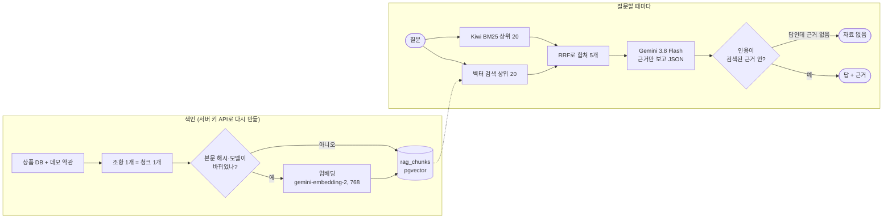

# 10. RAG: 상품·약관 질문에 근거와 함께 답하기

> **상품 DB와 이 앱의 규칙을 조항 형식으로 쓴 데모 약관을 조항 단위로 잘라 pgvector에 넣는다. 질문이 오면 벡터 검색과 단어 검색(Kiwi BM25)을 RRF로 합쳐 근거 5개를 찾고, Gemini 3.8 Flash가 그 근거만으로 답한다. 인용은 검색된 근거 안에서만 인정하고, 근거 없는 답은 "자료 없음"으로 바꾼다.**

결정 이유: [ADR 0013](../decisions/0013-agent-rag-plan.md)

## 어디에 쓰나

RAG는 **은행의 규칙과 상품 설명**을 묻는 질문에만 씁니다. "카드 대금 못 내면?", "자유적금 우대금리 조건?" 같은 질문입니다. "내 잔액 얼마야?" 같은 **내 데이터** 질문은 문서에 없으므로, 계좌·카드 API(나중에 Agent의 MCP 도구)로 답합니다.

## 코드 위치

| 하는 일 | API | 코드 |
|---|---|---|
| 문서 자르기 | (내부) | `rag/chunking.py` `doc_chunks`, `product_chunks` |
| 데모 약관 | | `rag/docs/*.md` (4개, 조항 22개) |
| 색인 갱신 (바뀐 것만 임베딩) | `POST /system/rag/reindex` (서버 키) | `rag/service.py` `reindex` |
| 검색 | `GET /rag/search?q=` 🔒 | `rag/service.py` `search`, `rrf_fuse`, `bm25_rank` |
| 답변 | `POST /rag/ask` 🔒 | `rag/service.py` `ask`, `PROMPT` |
| Gemini 연결 | | `rag/ai.py` (`GeminiAI`, 테스트는 가짜로 바꿔 끼움) |
| 평가 | `uv run python -m avengers_bank.domains.rag.evaluate` | `rag/evaluate.py`, `rag/golden.jsonl` (질문 38개) |

## 흐름



## 핵심 코드

RRF(Reciprocal Rank Fusion)는 점수가 아니라 **순위**만 씁니다.

```python
def rrf_fuse(rank_lists, k=60):
    for ranked in rank_lists:
        for rank, chunk_id in enumerate(ranked, start=1):
            score[chunk_id] = score.get(chunk_id, 0.0) + 1.0 / (k + rank)
```

벡터 거리(0~2)와 BM25 점수(0~수십)는 단위가 달라 그대로 더할 수 없습니다. 순위로 바꾸면 비교할 수 있고, 두 방식에서 모두 위에 있는 청크가 가장 앞에 옵니다.

## 왜 이렇게 했나

- **우리 문서를 쓴다**: 문서가 앱의 실제 규칙에서 나와서, 답이 틀리면 검색이 틀렸는지 문서와 코드가 어긋났는지 바로 압니다.
- **하이브리드 검색**: 벡터는 "카드값 못 내면"과 "연체"처럼 뜻이 같은 말을 찾고, BM25는 "PIN", "14일" 같은 정확한 낱말을 놓치지 않습니다.
- **조항 단위 청킹**: 약관은 조항 하나가 한 가지 규칙입니다. 글자 수로 자르면 한 규칙이 두 청크로 갈라집니다.
- **바뀐 것만 임베딩**: 무료 티어는 호출 수가 곧 한도입니다. 본문 해시와 임베딩 모델을 저장해 두고 달라진 것만 다시 부릅니다. 모델이 바뀌면 벡터가 호환되지 않으므로 전부 다시 합니다.
- **인용 검사는 서버가**: LLM이 없는 청크 id를 지어내도 응답에 나가지 않습니다. 답이라고 했는데 근거가 하나도 남지 않으면 "자료 없음"으로 바꿉니다.
- **질문은 `<질문>` 안에만**: 질문에 "이전 지시를 무시해" 같은 문장이 있어도 규칙이 아니라 질문 내용으로 다루라고 프롬프트에 적었습니다.
- **로그인 필요, 1분에 10번**: 상품·약관은 공개 정보지만 호출마다 무료 한도를 씁니다. 로그인한 사람만, 한 사람이 1분에 10번까지만 부를 수 있습니다. 한 사람이 한도를 다 쓰면 모두의 RAG가 멈추기 때문입니다.
- **벡터 개수 검사**: SDK는 `gemini-embedding-2`에 문자열 목록을 넘기면 하나로 합쳐 벡터를 1개만 돌려줍니다. 텍스트마다 `Content`로 감싸고, 돌아온 개수가 보낸 개수와 다르면 저장하지 않고 503을 냅니다. 개수가 다르면 `zip`이 조용히 잘라서 엉뚱한 청크에 벡터가 붙기 때문입니다.

## 테스트와 평가

- 테스트(`tests/test_rag.py`)는 **Gemini를 부르지 않습니다.** `conftest.py`가 진짜 연결을 끄고, 낱말을 해시로 768칸에 흩뿌리는 가짜 임베딩을 씁니다. `.env`에 진짜 키가 있어도 테스트는 쓰지 않습니다.
- 정답 세트 38문항의 정답 청크가 실제로 색인에 있는지 테스트가 확인합니다(문서를 고쳐 조항 번호가 바뀌면 바로 깨짐).
- 진짜 수치(Hit@1, Hit@5, MRR)는 키를 넣고 `evaluate` 명령으로 잽니다. 같은 질문의 임베딩은 방식(hybrid·vector·bm25)끼리 재사용해서 질문 수만큼만 부릅니다.

## 면접 예상 질문

**Q. 왜 벡터 검색만 쓰지 않았나요?**
A. 벡터는 뜻이 비슷한 문장을 잘 찾지만, 숫자나 고유한 낱말("PIN", "14일", "연회비")은 놓칠 때가 있습니다. BM25는 반대입니다. 두 결과를 RRF로 합치면 서로의 약점을 메웁니다. 지난 RAG 프로젝트에서 같은 설정으로 비교해 본 결과를 그대로 가져왔습니다.

**Q. LLM이 근거에 없는 내용을 지어내면요?**
A. 두 겹으로 막습니다. 프롬프트에서 근거에 있는 내용만 쓰고 근거 id를 인용하라고 하고, 서버는 인용 id가 실제로 검색된 청크인지 확인합니다. 답이라고 했는데 남는 인용이 없으면 "자료 없음"으로 바꿉니다. 다만 인용은 맞는데 문장을 조금 틀리게 요약하는 것까지는 막지 못합니다. 그건 답변 평가(채점 AI)로 잴 일입니다.

**Q. 상품이 바뀌면 RAG는 어떻게 알아요?**
A. 상품 청크는 DB에서 매번 다시 만듭니다. 색인 API를 부르면 본문 해시를 비교해 바뀐 상품만 다시 임베딩하고, 판매가 끝난 상품은 지웁니다. 청크 id가 DB id가 아니라 `product:savings:1`처럼 종류·상품 코드라서, seed를 다시 넣어도 같은 청크로 인식됩니다.

**Q. 가짜 AI로 테스트하면 실제 Gemini 연동 버그는 어떻게 잡나요?**
A. 가짜를 두 층으로 나눴습니다. 서비스 테스트는 `AI` 전체를 가짜로 바꾸고, Gemini 연결부 테스트는 SDK의 네트워크 직전(`aio.models`)만 가짜로 바꿉니다. 두 번째 테스트는 SDK의 실제 변환 함수(`t_contents`)를 불러서 "텍스트 3개를 보내면 요청도 3개가 되는지"를 확인합니다. PR 리뷰에서 찾은 벡터 합쳐짐 버그가 이 방법으로 테스트에 들어갔습니다.

**Q. pgvector인데 왜 인덱스(HNSW)를 안 만들었나요?**
A. 청크가 수십 개라 전부 비교해도 빠르고, 근사 인덱스는 정확도를 조금 잃습니다. 청크가 수만 개가 되면 HNSW 인덱스를 추가합니다.
