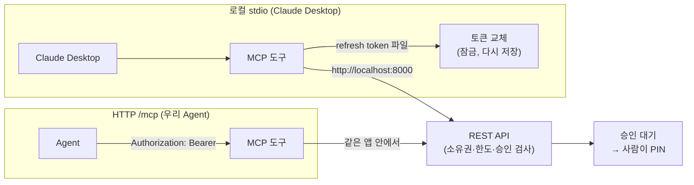

# 11. MCP 서버: AI가 내 은행을 쓰는 입구

> **MCP 서버는 은행 기능을 AI가 쓸 수 있는 도구 16개로 묶은 얇은 층이다. 도구는 DB를 보지 않고 사용자 토큰으로 REST API만 부른다. 그래서 AI는 사용자보다 큰 권한을 가질 수 없고, 돈은 여전히 PIN 없이 움직이지 않는다.**

결정 이유: [ADR 0014](../decisions/0014-mcp-server.md), [ADR 0004](../decisions/0004-agent-integration.md)

## MCP가 뭔가

MCP(Model Context Protocol)는 AI 앱(Claude Desktop, 우리 Agent 등)이 외부 도구를 부르는 표준 규약입니다. 서버가 "이런 도구가 있다(이름, 설명, 입력 형식)"를 알려 주면, AI가 대화를 보고 알맞은 도구를 골라 부릅니다.

## 코드 위치

| 하는 일 | 코드 |
|---|---|
| 도구 16개 정의 | `mcp_server/server.py` |
| REST 호출, 토큰 고르기 | `mcp_server/api.py` (`call`, `token_for`, `TokenFile`) |
| 로컬 실행·로그인 | `mcp_server/__main__.py` |
| 앱에 붙이기 | `main.py` (`app.mount("/mcp", ...)`, lifespan) |
| 요청한 곳 기록 | `core/dependencies.py` `get_requested_by` |

## 두 가지 입구



## 핵심 코드

모든 도구는 한 줄짜리 어댑터입니다.

```python
@mcp.tool(annotations=REQUEST)
async def request_transfer(ctx, from_account_id, to_account_num, amount, memo=None):
    """이체 요청. 돈을 바로 보내지 않고 승인 대기를 만든다 ..."""
    return await call(ctx, "POST", "/transfers", body={..., "idempotency_key": new_key()})
```

`call`은 토큰을 붙여 REST를 부르고, 실패하면 서버의 오류 코드와 메시지를 그대로 도구 오류로 돌려줍니다. 그래서 "남의 카드는 404", "한도 초과" 같은 규칙이 웹과 똑같습니다.

## 왜 이렇게 했나

- **REST만 부른다**: 도구가 service를 직접 부르면 인증·소유권 검사를 빠뜨리기 쉽습니다. REST를 거치면 웹과 같은 검사를 반드시 지납니다.
- **토큰 파일 + 잠금**: refresh token은 쓸 때마다 바뀌고, 옛 토큰이 다시 오면 도난으로 보고 로그인을 끊습니다. 두 도구가(또는 Claude Desktop과 Claude Code가 띄운 두 서버가) 동시에 토큰을 바꾸면 한쪽이 옛 토큰을 쓰게 되므로, 교체는 잠금 안에서 한 번만 하고 새 토큰을 바로 파일에 씁니다. 프로세스 사이는 "없을 때만 만들기"로 여는 잠금 파일로 막고, 잠근 뒤 파일을 다시 읽어서 뒤에 온 쪽은 바뀐 토큰을 씁니다.
- **요청 번호는 인자로 정한다**: 같은 도구·같은 인자·같은 10분이면 같은 번호라서, AI가 시간 초과로 다시 불러도 승인 대기가 하나만 남습니다. 무작위로 만들면 둘이 생기고, 사용자가 둘 다 승인하면 두 번 보내집니다.
- **도구 설명이 곧 안전 장치의 일부**: "PIN을 묻지 마라", "승인 대기만 만든다"를 서버 안내문과 도구 설명에 적었습니다. 다만 진짜로 막는 것은 서버의 승인 규칙입니다.
- **`requested_by = MCP`**: 승인 화면이 "AI가 만든 요청"이라고 보여 주면 사용자가 한 번 더 확인합니다. 헤더 값이라 위조할 수 있어서 정보용으로만 씁니다.

## 면접 예상 질문

**Q. AI가 사용자 토큰을 가지면 돈을 마음대로 보낼 수 있지 않나요?**
A. 토큰으로 할 수 있는 것은 "이체 요청"까지입니다. 실행은 승인 대기를 사람이 은행 화면에서 PIN으로 승인해야 하고, 승인 API는 MCP 도구에 없습니다. PIN을 바꾸려면 비밀번호도 필요해서 토큰만으로는 PIN을 바꿔 스스로 승인할 수도 없습니다.

**Q. MCP의 destructiveHint로 위험한 도구를 막으면 되지 않나요?**
A. 힌트는 MCP 앱에게 주는 표시일 뿐이고, 어떤 앱은 무시하고 바로 실행합니다. 그래서 힌트는 달아 두되, 막는 것은 서버의 승인 규칙에 맡겼습니다.

**Q. 로컬 MCP는 비밀번호를 어떻게 다루나요?**
A. 저장하지 않습니다. `login` 명령에서 한 번 입력받아 로그인하고 refresh token만 파일에 둡니다. 로그아웃하거나 14일 동안 안 쓰면 그 토큰은 무효가 됩니다.

**Q. 테스트는 어떻게 했나요?**
A. 도구 로직은 FastMCP로 직접 부르고, 그 도구가 부르는 REST는 테스트 앱으로 연결했습니다. HTTP `/mcp`는 실제 MCP 요청(JSON-RPC `tools/call`)을 보내서 Bearer 토큰이 넘어가는지, 없으면 오류가 나는지 확인했습니다. 토큰 파일은 두 도구가 동시에 불려도 교체가 한 번만 일어나는지 확인했습니다.
