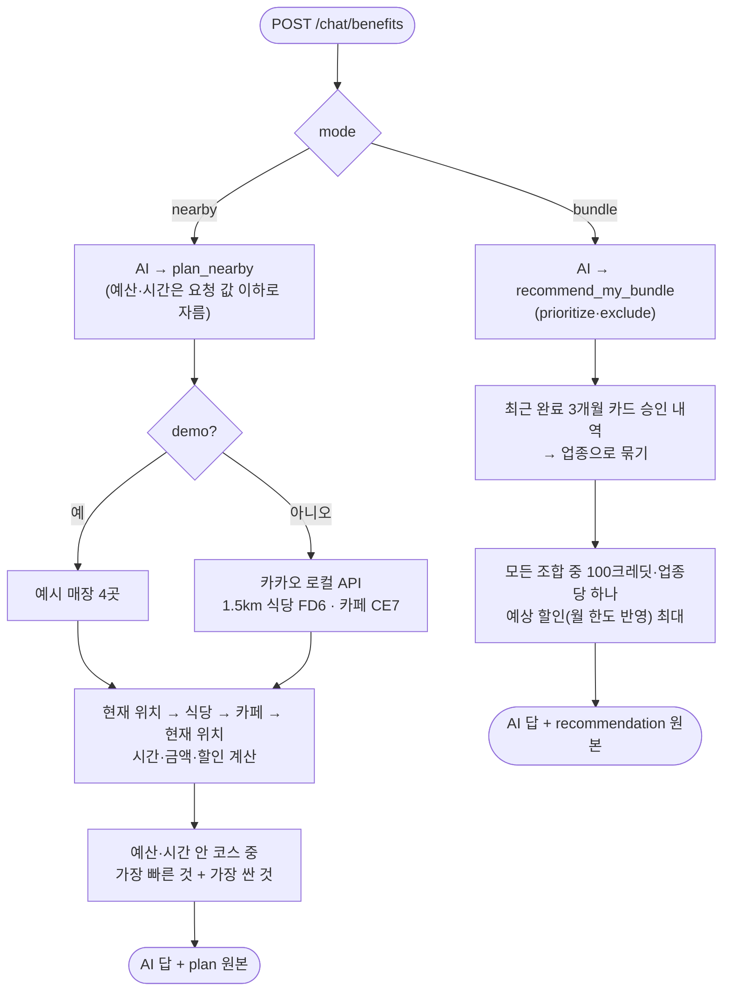

# 14. 카드 혜택 구성과 주변 코스

> **할인율·크레딧은 은행 카탈로그(코드)에만 있고, 추천 조합과 코스 금액도 코드가 계산한다. AI는 도구를 불러 그 결과를 설명만 하고, 응답에는 계산 원본이 같이 붙는다. 저장한 구성은 미리보기라 실제 결제 금액은 바뀌지 않는다.**

결정 이유: [ADR 0023](../decisions/0023-card-protection-and-benefits.md)

## 코드 위치

| 하는 일 | API | 코드 |
|---|---|---|
| 카탈로그와 내 구성 조회 | `GET /products/benefits` | `products/benefits.py` `get_benefits` |
| 구성 저장 (검증) | `PUT /products/benefits` | `products/benefits.py` `save_benefits`, `validate_bundle` |
| 혜택 카탈로그 (6개, 100크레딧) | | `products/benefits.py` `CATALOGUE`, `CREDIT_BUDGET` |
| 최근 3개월 소비로 조합 추천 | (AI 도구 `recommend_my_bundle`) | `products/benefits.py` `recommend_bundle` |
| 주변 식당·카페 검색 | (AI 도구 `plan_nearby`) | `products/nearby.py` `find_places`, `kakao_places`, `demo_places` |
| 코스 시간·금액 계산 | | `products/nearby.py` `quote_routes` |
| 확인된 쿠폰 목록 | | `products/benefit_coupons.json` (지금 비어 있음) |
| 혜택 상담 | `POST /chat/benefits` | `agent/benefits.py` `ask_benefits`, 요청·응답 `agent/schemas.py` `BenefitsChatRequest` |
| 요청·응답 모양 | | `products/benefit_schemas.py` |
| 시연 화면 | `/app/benefits.html` | `frontend/benefits.mjs` |
| 저장 칸 | | `users.benefit_bundle` JSON, 마이그레이션 `76d5bb82ac41` |
| 테스트 | | `tests/test_benefits.py` |

## 요청 흐름



## 핵심 코드

```python
# 저장: 카탈로그에 있는지, 100크레딧 이내·업종당 하나인지
def validate_bundle(offer_ids):
    if any(key not in CATALOGUE for key in offer_ids):
        raise BadRequestException(..., code="UNKNOWN_BENEFIT")
    bundle = make_bundle([CATALOGUE[key] for key in offer_ids])
    if not valid_bundle(bundle):
        raise BadRequestException(..., code="BENEFIT_CONSTRAINT")
```

```python
# 추천 점수: 우선 업종 포함 → 예상 할인 → 적은 크레딧 순
score = (any(offer.group == prioritize for offer in choices),
         sum(values[offer.offer_id] for offer in choices), -bundle.credits)
```

코스 할인은 한 매장에 하나만 고릅니다: 기존 체크카드 카페 5%(결제 가능한 체크카드가 있을 때), 저장한 구성 미리보기(`preview_bundle`, 이번 달 남은 한도 안), 쿠폰 중 **할인이 가장 큰 것**. 쿠폰 없는 금액(`total_without_coupons_won`)도 같이 돌려줍니다.

## 왜 이렇게 했나

- **숫자는 코드가 정한다**: AI가 할인율이나 조합을 지어내면 은행이 약속하지 않은 혜택이 됩니다. 카탈로그는 코드에 고정하고, 저장 API도 같은 카탈로그로 검증합니다.
- **원본을 응답에 붙인다**: AI 답 아래에 `recommendation`·`plan`을 그대로 줘서, 화면은 AI 문장이 아니라 계산 결과로 숫자를 그립니다.
- **AI가 정한 조건은 요청 값을 넘지 못한다**: `plan_nearby`의 예산·시간은 `min(AI 값, 요청 값)`입니다. 대화에 섞인 말로 사용자가 정한 한도를 넘는 코스를 만들지 않습니다.
- **조합은 전부 계산한다**: 혜택이 6개라 조합 수가 작아서, 탐욕법 대신 모든 조합을 봅니다.
- **완료된 달만 본다**: 이번 달은 아직 끝나지 않아 소비가 적게 보입니다. 지난 3개월 합계를 3으로 나눠 월 예상 할인을 냅니다.
- **위치를 로그에 남기지 않는다**: httpx는 요청 URL 전체를 로그에 찍는데, 카카오 검색 URL에 좌표가 들어갑니다. 그 로그만 걸러냅니다.
- **키가 없어도 시연한다**: `KAKAO_LOCAL_API_KEY`가 없으면 실제 검색은 `503 PLACE_SEARCH_DISABLED`지만, `demo: true`면 예시 매장·예시 가격으로 같은 계산을 합니다.
- **상담은 읽기 전용**: 도구 두 개 모두 조회·계산만 합니다. 구성 저장은 사용자가 화면에서 `PUT /products/benefits`로 합니다.

## 한계

- 업종은 가맹점 이름과 거래 카테고리로 추정합니다(`merchant_group`, `shortcut` 주석). 실제로는 가맹점 ID와 업종 코드가 필요합니다.
- 실제 검색의 가격은 사용자가 넣은 예상 가격이고, 시간은 직선 거리 × 1.25를 분당 70m로 나눈 추정치에 식사·카페 시간을 더한 값입니다.
- 쿠폰 파일은 비어 있습니다. `https` 출처가 있고 유효기간 안인 쿠폰만 씁니다.

## 면접 예상 질문

**Q. AI가 "빽다방 20% 할인"이라고 말하면요?**
A. 그런 혜택은 카탈로그에 없어서 저장 API가 `400 UNKNOWN_BENEFIT`으로 막습니다. 화면의 숫자는 AI 문장이 아니라 응답의 `recommendation` 원본에서 그립니다.

**Q. 사용자가 "예산 2만 원"이라 했는데 AI가 5만 원으로 도구를 부르면요?**
A. 서버가 요청 본문의 `budget_won`과 비교해 작은 값으로 자릅니다. AI가 조건을 넓힐 수 없습니다.

**Q. 왜 조합을 전부 계산하나요? 느리지 않나요?**
A. 혜택이 6개라 조합이 63개뿐입니다. 탐욕법은 크레딧 제약 때문에 최적을 놓칠 수 있어서 전부 봤습니다. 카탈로그가 커지면 배낭 문제 DP로 바꿉니다.

**Q. 카카오 API가 죽으면요?**
A. `503 PLACE_SEARCH_UNAVAILABLE`로 바로 알려 줍니다. 타임아웃은 5초입니다. 시연 모드는 외부 호출 없이 동작합니다.
