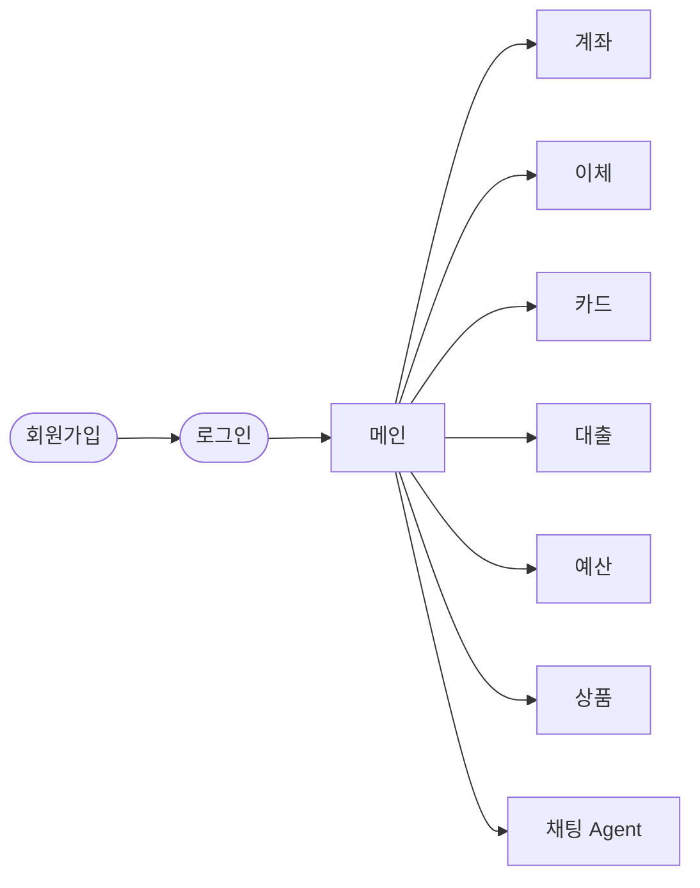

# 화면 구성

> **로그인을 거쳐 메인 화면으로 들어오고, 메인 화면에는 총자산과 잔액이 많은 계좌 3개, 그리고 업무별 메뉴가 있다.**

- 화면의 **디자인(색·글꼴·배치 세부)은 나중에** 정합니다. 이 문서는 화면마다 **무엇을 보여주는지**와 그 데이터가 어디서 오는지만 정합니다.
- 화면은 모바일 웹 기준입니다([scope.md](scope.md) 🟡 화면).

## 화면 흐름

## 로그인

| 보여주는 것 | 데이터 |
|---|---|
| 아이디, 비밀번호 입력 | `POST /users/login` |
| 실패 안내: 불일치, **5회 실패 잠금** | `401 INVALID_CREDENTIALS`, `423 LOGIN_LOCKED` |
| 회원가입으로 가기 | `POST /users/signup` (생년월일 필수, 마케팅 동의 선택) |

## 메인

| 영역 | 보여주는 것 | 데이터 |
|---|---|---|
| 총자산 | 내 계좌 잔액 합계 | `GET /accounts`의 총합 (계좌 조회 PR에서 구현) |
| 대표 계좌 | **잔액이 많은 순 3개**: 별칭(없으면 상품명), 계좌번호, 잔액 | 같은 응답에서 잔액 내림차순 상위 3개 |
| 메뉴 | 업무별로 나눔: 계좌, 이체, 카드, 대출, 예산, 상품, 채팅 | 각 메뉴의 화면 |

- 총자산은 **해지하지 않은 계좌**(`status ≠ CLOSED`)의 `balance` 합계입니다. 대출은 갚을 돈이라 총자산에 더하지 않고, 대출 기능을 만들 때 "대출 잔액"으로 따로 보여 줄지 정합니다.
- 예산 관리를 신청한 사용자에게 메인에 **자유 사용 가능액**을 보여 줄지는 예산 기능을 만들 때 정합니다.
- 계좌가 3개보다 적으면 있는 만큼만, 없으면 "계좌 만들기" 안내를 보여 줍니다.

## 메뉴별 화면 (초안)

| 메뉴 | 주요 화면 | 만드는 PR |
|---|---|---|
| 계좌 | 내 계좌 목록, 계좌 상세(예·적금은 금리·만기), 거래내역, 개설 | 계좌 개설·조회 |
| 이체 | 받는 사람·금액 입력 → **승인 화면(PIN)** | 이체 |
| 카드 | 내 카드, 사용내역, 정지 | 카드 |
| 대출 | 한도 조회, 신청, 상환 일정 | 대출 |
| 예산 | 자유 사용 가능액, 주기 현황, 목표 | 예산 관리 |
| 상품 | 상품 목록·상세·가입 조건 | 상품 |
| 채팅 | 자연어 요청, 승인 화면으로 가는 링크 | Agent |

승인 화면(PIN 입력)은 어느 메뉴에서든 돈이 움직이면 나오는 **공통 화면**입니다([ADR 0004](../decisions/0004-agent-integration.md)). Agent는 이 화면으로 가는 링크만 줄 수 있습니다.
