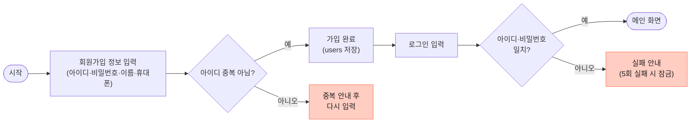
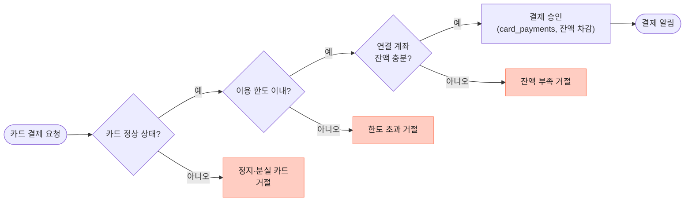
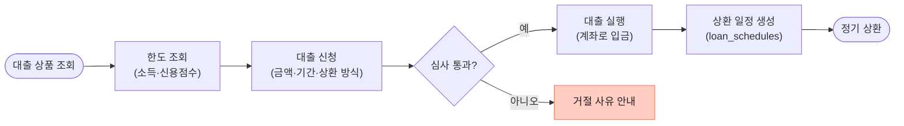
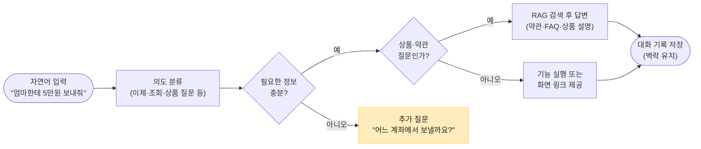

# 주요 이용 흐름

FigJam "주요 이용 흐름 (초안)"을 옮겼습니다. 마름모는 판단, **빨간 상자는 실패 상황**입니다. 실패 상황은 README의 "직접 선정한 실패 상황의 동작 확인"에 그대로 씁니다.

> 흐름 안의 테이블 이름(`users`, `accounts`, `transactions` 등)은 FigJam DB 초안 기준입니다. 현재 ERD와의 대응은 [맨 아래 표](#테이블-이름-대응)를 보세요.

## ① 회원가입 · 로그인

## ② 상품 조회 · 계좌 개설

## ③ 계좌 이체

## ④ 카드 결제

## ⑤ 대출 신청 · 실행

## ⑥ 자연어 요청 (AI · RAG)

"추가 질문"은 실패가 아니라 되묻기라서 노란색입니다. 사용자가 답하면 다시 의도 분류부터 판단합니다.

## 실패 상황 모음

README의 "실패 상황 동작 확인"에 쓸 후보입니다. 구현하면서 실제 응답(`error.code`)을 채웁니다.

| 흐름 | 실패 상황 | 예상 응답 |
|---|---|---|
| ① | 이미 있는 아이디로 가입 | `409 LOGIN_ID_ALREADY_EXISTS` ✅ 구현됨 |
| ① | 아이디·비밀번호 불일치 | `401 INVALID_CREDENTIALS` ✅ 구현됨 |
| ① | 5회 연속 실패 후 로그인 | 미정 |
| ② | 가입 조건 불충족 | 미정 |
| ② | 출금 계좌 잔액 부족 | `400 INSUFFICIENT_BALANCE` (예정) |
| ③ | 없는 계좌로 이체 | `404 ACCOUNT_NOT_FOUND` (예정) |
| ③ | 1회·1일 한도 초과 | `400 PER_TRANSFER_LIMIT_EXCEEDED`, `400 DAILY_LIMIT_EXCEEDED` (예정) |
| ③ | 남의 계좌에서 출금 | `403 ACCOUNT_FORBIDDEN` (예정) |
| ④ | 정지·분실 카드 결제 | 미정 |
| ④ | 카드 한도 초과, 연결 계좌 잔액 부족 | 미정 |
| ⑤ | 대출 심사 거절 | 미정 |
| ⑥ | 정보가 부족한 자연어 요청 | 추가 질문으로 응답 |

예정 코드는 `docs/API_ENDPOINTS.md`에 적힌 값입니다.

## 테이블 이름 대응

| 흐름에 적힌 이름 (FigJam 초안) | 현재 ERD (`docs/ERD.md`) |
|---|---|
| `users` | `users` |
| `accounts` | `checking_accounts`, `deposit_accounts`, `savings_accounts` |
| `transactions` | `checking_account_histories`, `deposit_account_histories`, `savings_account_histories` |
| `card_payments` | `credit_card_histories`, `debit_card_histories` |
| `loan_schedules` | 없음 (대출 테이블 미정) |
