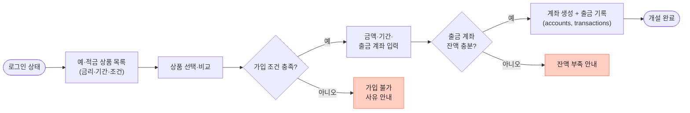
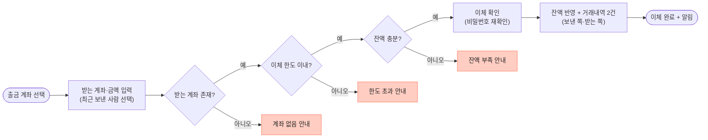
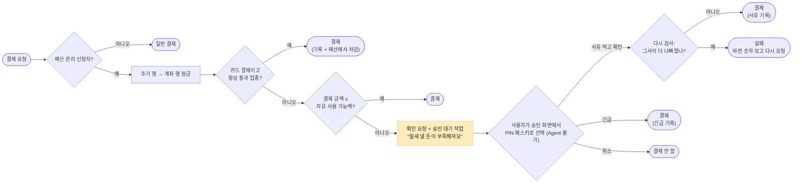
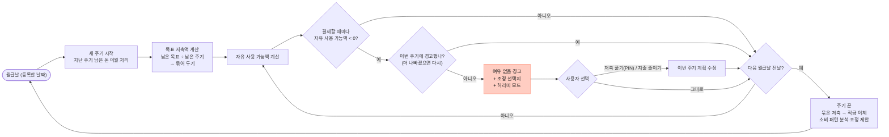

# 주요 이용 흐름

①~⑥은 FigJam "주요 이용 흐름 (초안)"을 옮긴 것이고, ⑦⑧은 이 레포에서 추가한 예산 관리 흐름입니다. ⑤ 대출은 [scope.md](scope.md)에서 가볍게 만드는 범위입니다. 마름모는 판단, **빨간 상자는 실패 상황**, 노란 상자는 사용자 확인입니다. 실패 상황은 README의 "직접 선정한 실패 상황의 동작 확인"에 그대로 씁니다.

> 흐름 안의 테이블 이름(`users`, `accounts`, `transactions` 등)은 FigJam DB 초안 기준입니다. 현재 ERD와의 대응은 [맨 아래 표](#테이블-이름-대응)를 보세요.

## ① 회원가입 · 로그인

## ② 상품 조회 · 계좌 개설

## ③ 계좌 이체

## ④ 카드 결제

## ⑤ 대출 신청 · 실행

## ⑥ 자연어 요청 (AI · RAG)

"추가 질문"은 실패가 아니라 되묻기라서 노란색입니다. 사용자가 답하면 다시 의도 분류부터 판단합니다.

## ⑦ 결제할 때 예산 검사

예산 관리를 신청한 사람의 체크카드·신용카드·계좌 이체에 적용합니다(검사 대상은 추천안, 결정 대기). 자세한 규칙: [budget.md](budget.md)

## ⑧ 예산 주기

실제 월급이 들어오면 그 주기의 수입을 실제 금액으로 바꾸고 자유 사용 가능액을 다시 계산합니다. 월급이 늦게 들어와도 주기는 날짜에 시작합니다.

## 실패 상황 모음

README의 "실패 상황 동작 확인"에 쓸 후보입니다. 구현하면서 실제 응답(`error.code`)을 채웁니다.

| 흐름 | 실패 상황 | 예상 응답 |
|---|---|---|
| ① | 이미 있는 아이디로 가입 | `409 LOGIN_ID_ALREADY_EXISTS` ✅ 구현됨 |
| ① | 아이디·비밀번호 불일치 | `401 INVALID_CREDENTIALS` ✅ 구현됨 |
| ① | 5회 연속 실패 후 로그인 | 미정 |
| ② | 가입 조건 불충족 | 미정 |
| ② | 출금 계좌 잔액 부족 | `400 INSUFFICIENT_BALANCE` (예정) |
| ③ | 없는 계좌로 이체 | `404 ACCOUNT_NOT_FOUND` (예정) |
| ③ | 1회·1일 한도 초과 | `400 PER_TRANSFER_LIMIT_EXCEEDED`, `400 DAILY_LIMIT_EXCEEDED` (예정) |
| ③ | 남의 계좌에서 출금 | `403 ACCOUNT_FORBIDDEN` (예정) |
| ④ | 정지·분실 카드 결제 | 미정 |
| ④ | 카드 한도 초과, 연결 계좌 잔액 부족 | 미정 |
| ⑤ | 대출 심사 거절 | 미정 |
| ⑥ | 정보가 부족한 자연어 요청 | 추가 질문으로 응답 |
| ⑦ | 자유 사용 가능액을 넘는 결제 | `409 BUDGET_CONFIRMATION_REQUIRED` (예정, API_ENDPOINTS 미반영) |
| ⑦ | 신용카드 결제와 이체가 동시에 와서 둘 다 예산을 넘김 | 하나만 통과 (예정, 주기 행 잠금) |
| ⑦ | Agent가 예산 초과 결제를 확인하려 함 | 거부 (예정, Agent 도구에 확인 API 없음) |
| ⑦ | 확인하는 사이 예산이 더 줄어듦 | 새 확인 요청 (예정, 확인 때 다시 검사) |
| ⑧ | 주기 중간에 자유 사용 가능액이 마이너스 | 여유 없음 경고 + 조정 선택지 (예정) |

"(예정)" 코드 중 ③의 이체 관련 코드는 `docs/API_ENDPOINTS.md`에 적힌 값이고, 나머지는 API를 설계할 때 그 문서에 추가합니다.

## 테이블 이름 대응

| 흐름에 적힌 이름 (FigJam 초안) | 현재 ERD (`docs/ERD.md`, ADR 0003) |
|---|---|
| `users` | `users` |
| `accounts` | `accounts` (+ 예·적금은 `account_terms`) |
| `transactions` | `account_transactions` |
| `card_payments` | `card_transactions` |
| `loan_schedules` | `loan_schedules` |
